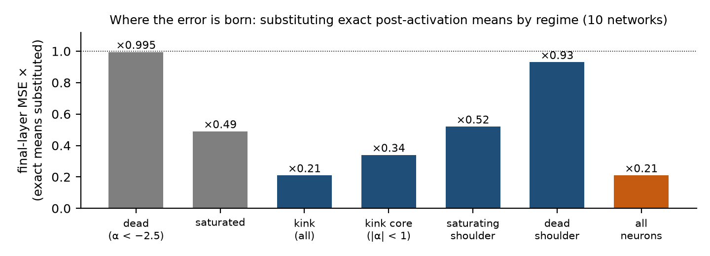

## 2. Where the error lives

Every design decision in §3 and every closure in §6 was made against an **oracle-substitution** measurement: run the
chain, and at chosen layers replace one quantity of its state by its Monte-Carlo value (10⁷ samples, two independent
seeds so that the oracle's own noise can be measured and subtracted), then see what that is worth on the final layer.
The measurements below are the ones the rest of the document leans on. All are upper bounds on what *any* method
could gain through the substituted quantity, and we label them as such.

**(a) The Gaussian-closure error is a mean error, and the parts of the state multiply [M].** Covariance propagation
(the linear step exact, a Gaussian closure at every ReLU) has raw error 5.15e-6 on our first three networks. Injecting
exact quantities into it, one at a time and together (Part I of this project, `state_split3`):

| upstream mean | upstream covariance | Edgeworth readout | final-layer MSE | vs k = 2 |
|---|---|---|---|---|
| chain's | chain's | no | 5.15e-6 | 1× |
| exact | chain's | no | 2.22e-7 | 23× |
| exact | chain's | yes | 1.84e-7 | 28× |
| k = 3 chain's | k = 3 chain's | yes | 6.41e-8 | 80× |
| exact | k = 3 chain's | yes | 2.94e-8 | **175×** |

A perfect final readout alone is worth 1.08× on a bad state and 3.8× on a good one: no component can be judged in
isolation, and the third cumulant's job is to get the *propagated means* right.

**(b) The remaining error is born in the kink core of every layer, not in the tails [M].** On the current chain,
substituting exact post-activation means for one activation regime at a time (ten networks; a cloud session):
dead neurons (α = μ/σ < −2.5) ×0.995, saturated ×0.49, the kink ×0.21, all ×0.21; inside the kink, the core
(|α| < 1) ×0.34, the saturating shoulder ×0.52, the dead shoulder ×0.93. About four fifths of the final error travels
through intermediate means and is born **where the ReLU is most nonlinear and the Edgeworth series most reliable**:
fed exact moments, our first-order readout is accurate to ~1e-12 of the layer MSE in both tails and ~1e-10 in the kink.
The tails, which the Phase-1 literature and our own first hypothesis blamed, hold none of it; a 149-arm screen of
tail-term restrictions found nothing beyond §3.5's consistency fixes.

<figure><figcaption>Figure 1. Oracle substitution of exact post-activation means, one activation regime at a time (ten networks, ×  of the chain's final-layer MSE). The dead regime holds nothing; the kink core, where the ReLU is most nonlinear, holds most of the error.</figcaption></figure>

**(c) The channels only work together [M].** Exact pre-activation moments of the kink neurons substituted at every
layer: variance alone ×0.64 / ×0.82 (two networks), κ₄ alone ×0.78, κ₃ alone ×0.88 — and **all three at once ×0.12 /
×0.13**. Exact variance alone is even *harmful* on one network (×1.09 when substituted for all neurons). The chain's
errors in its channels are mutually consistent, and a correction of one channel breaks that consistency; this is the
same phenomenon as §3.5 seen from the oracle side, and it is the reason §3.7's corrector touches one channel only.

**(d) What the per-neuron errors are made of [M + D].** §6.4 proves and measures that the next layer's per-neuron
variance error is, 95% of it, a random projection of the off-diagonal post-covariance error through the next layer's
independent weights — the reason every learned per-neuron correction of the variance failed, and the reason the
oracle reserve of (c), real as it is, is out of reach of anything cheap.

So the target is sharply posed: the error is in the per-neuron moments of kink-core neurons, it is jointly
consistent across channels, and its rough part is a projection of joint-cumulant errors. §3 is what we could fix
within that; §6 is why the rest resists.
