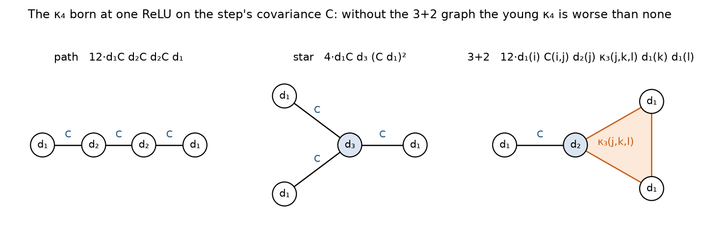
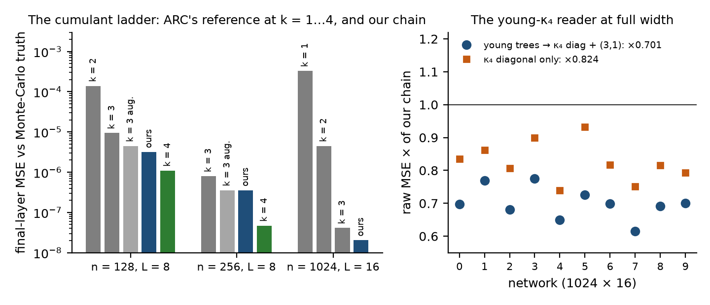

## 7. One order up: where the missing accuracy is, and what it costs in this representation

The last thing we measured asks where the leaders' accuracy comes from. Wu et al.'s error law is cK(L/n)K, and our
own ladder at 1024×16 follows it: k = 1, 2, 3 give 3.3e-4, 4.5e-6 and 4.1e-8. At small width, where ARC's k_max = 4
(the full fourth cumulant, carried factorised) is affordable, we ran the reference ladder and our chain against
Monte-Carlo ground truth at 10⁷ samples (Figure 7, left) [M]:

| final-layer MSE | ARC k = 3 | **our chain** | ARC k = 3 augmented | **ARC k = 4** |
|---|---|---|---|---|
| n = 128, L = 8 | 9.4e-6 | 3.18e-6 | 4.5e-6 | 1.10e-6 (×0.34 of ours) |
| n = 256, L = 8 | 8.0e-7 | 3.55e-7 | 3.58e-7 | ≈4.7e-8 (×0.13–0.17) |

Our chain sits at the level of the augmented k = 3 at both widths, as at 1024×16. In the reference, k = 3 augmented
and k = 4 sum the same Edgeworth diagrams; the only difference is that k = 4 carries the fourth cumulant completely, and
that alone is ×3 at L/n = 1/16 and ×6–7 at 1/32. Susupro (forum 18254, posted after this write-up) ran exact K = 4 at
1024 × 16 outside the budget: ×11.8 below augmented K = 3 at L/n = 1/64 (1.72e-9 on networks 0–4 against our graded
2.03e-8), which continues the trend; at that width the
exact (3,1) slice holds at most 10% of K = 4's log gain and removing the carried C·κ₃ births costs ×5.39, so the gain
sits in the births there too (§7.1, §7.2). Exact k = 4 costs ≈L²n⁴, far outside the budget at 1024×16, so we
took its gain apart with the chain as the instrument: k = 4's per-layer statistics substituted into our chain upstream
of its last step, then k = 4's κ₄ split by where and how it was born (a full factorial over channels on 8 networks at
each of n = 128 and n = 256; the age and tree splits on 3) [M].

### 7.1 Which statistics, which age, which births

- **Which statistics.** Over the 2⁸ subsets of the eight per-layer channels our step reads, the core is the κ₄ diagonal
  together with its (3,1) slice: ×0.64 at n = 256 and ×0.60 at n = 128 for the pair, the strongest synergy of all 28
  pairs. The covariance and the (2,2) slice follow by themselves (dropping them from the full set costs nothing); each
  channel alone is worth little. That is §3.5's consistency principle one order up.
- **Which age.** ARC appends the κ₄ born at each ReLU as its own block of factors, so a block's age is known. Our closure
  explains only 48–73% of k = 4's κ₄ diagonal, and what it misses sits in the blocks born in the last two layers: those
  blocks exact, plus the closure for everything older, recover the whole gain of the exact fourth cumulant (n = 256:
  ×0.61 / 0.47 / 0.60 against ×0.60 / 0.43 / 0.54 for all of k = 4). The closure set to k = 4's own level, without the
  young pattern, is worse than ours.
- **Which births.** The young κ₄ is a set of trees on the step's covariance C (Figure 6): the path 12·d₁C d₂C d₂C d₁, the
  star 4·d₁C d₃ (C d₁)², and the graph in which the whole third cumulant is handed on through one covariance edge,

  > κ₄post(i, j, k, l) ⊃ 12 · d₁(i) C(i, j) d₂(j) κ₃pre(j, k, l) d₁(k) d₁(l)        ("3+2") [D]

  obtained by expanding y = ReLU(z) to second order in δz around the mean, taking the fourth joint cumulant with
  Leonov–Shiryaev, and keeping the terms linear in κ₃pre (checked against ARC's tree blocks to 1e-16). Switching the
  trees on one at a time in ARC's own step: without the 3+2 graph the young κ₄ is worse than none; the paths matter,
  the stars less; the repeated-index block, where the self-variance transfer κ₄(a,a,b,c) += 2·var_a d₁d₂ d₁d₁ κ₃(a,b,c)
  lives, is secondary. That is why the κ₄ carriers we had built first, all of which carried that transfer and not the
  3+2 graph, moved the final error by ×0.87–1.11, differently on different networks.

<figure><figcaption>Figure 6. The three κ₄ trees born at one ReLU on the step's covariance C, with the Wick gate at each node (d_k = E[ReLU⁽ᵏ⁾(z)] under the Gaussian closure). The 3+2 graph hands the whole third cumulant of the pre-activations, all-distinct part included, to the fourth cumulant of the post-activations through one covariance edge; it is then inherited through the next layers' weights.</figcaption></figure>

A one-line reading of the 3+2 graph, which we offer as interpretation [U]: the fourth cumulant that matters is the
third cumulant one ReLU later. The chain already carries κ₃ in full for its own readout; what the next order adds is
the same object, gated once more and read into κ₄.

### 7.2 A reader of the young trees from the chain's own state

We built the young trees from what the chain already holds — its covariance, its Wick gates and its κ₃ sources —
carried them for two layers on dense legs, and read them into the κ₄ diagonal and the (3,1) slice, adding only the part
beyond the closure's pattern so that the closure keeps its own level. The tree construction reproduces ARC's tree blocks
to 1e-16, and the leg implementation the factorised one to 1e-14 [M]:

| × of our chain's final-layer MSE | n = 256, L = 8 (4 networks) | **1024 × 16 (10 networks)** |
|---|---|---|
| young trees → κ₄ diagonal + (3,1) slice | ×0.62–0.67 on three, ×0.94 on the fourth | **×0.701 (better on 10/10; 0.62–0.78)** |
| … κ₄ diagonal only | ×0.72–0.76, ×1.01 | ×0.824 (10/10) |
| … trees born in the last layer only | ×0.71–0.80, ×0.98 | ×0.815 (10/10) |
| … with the band basis of §3.6 in the chain | — | ×0.72 (3 networks) |

<figure><figcaption>Figure 7. Left: the cumulant ladder against Monte-Carlo truth. At small width ARC's k = 4 is ×3 (n = 128) to ×6–7 (n = 256) better than our chain, which sits at the augmented k = 3's level; at 1024 × 16 the reference's own k = 1, 2, 3 and our designated estimator. Right: the young-tree reader at full width, per network — the first κ₄ carrier in this work that improves every network.</figcaption></figure>

This is the first κ₄ carrier in this work that improves every network, and ×0.70 of our raw error is close to the
leaders' raw error (1.1–1.3e-8 for the first three at the close, against our 2.03e-8). Read against the final board,
raw 1.42e-8 would score 2.6e-9 at our utilisation (≈ 30th place), 2.0e-9 at 14% (≈ 16th) and 1.42e-9 at the 10% floor,
level with the third entry [D]. The accuracy
for the top of the board is in this chain; the cost of carrying κ₃ (§6.1–§6.2) is what stands between the two.

### 7.3 The same, inside ARC's own algorithm

If the gain lives in young κ₄, ARC's factored k = 4 should not need its old κ₄ blocks either. It appends 2n factor
columns per ReLU, so its κ₄ work grows like L². We ran it with the blocks older than a layers removed after every linear
step, either dropped or replaced by one scale-mixture block v (C⊗C)sym whose level v is fitted on the dropped
blocks' diagonal, O(n r) (the stepped run reproduces `mlp_kprop` to 1.6e-16; nothing dropped reproduces it exactly) [M]:

| share of k = 4's gain over k = 3 kept | 128 × 8 (8 nets) | 256 × 8 (3) | 256 × 16 (3) |
|---|---|---|---|
| blocks of age ≤ 2, the rest dropped | 78% | 43% | 1% |
| age ≤ 1 + one scale-mixture block | 85% | 89% | 63% |
| age ≤ 2 + one scale-mixture block | 92% | 95% | 78% |
| age ≤ 3 + one scale-mixture block | 97% | 98% | **89%**, at 0.40 of the κ₄ columns and 0.61 of the wall time |

Dropping old κ₄ fails inside ARC's algorithm, because nothing else carries its level (in our chain the closure did);
one scale-mixture block restores it. The age that keeps about 90% grows slowly with depth, and the wall-time saving is
smaller than the column saving, because most of ARC's k = 4 step, which costs 66–207 times k = 3's wall time here, is not
its κ₄ columns. For ARC this is a practical knob, not a cheap k = 4 (`experiments/2026-10-14_k4age`).

### 7.4 Why it is not in the designated submission

The readers are dense products over the hubs of the young generations [M]. The cheap ones, the path with coinciding
hubs and the star, are O(n²) and alone they are worse than nothing (×1.05). The one that matters, the 3+2 graph, needs
the cross-layer pairing Dx(a, r) = κ₃(z_r at birth; z_a, z_a now). We found it inside the D pairing the chain already
computes: pair with the single legs as they were before their transport, then recover D = Dx·W with one product per
age. Metered in the shipped estimator with exact-shape stubs: +0.22% of the FLOPs per product, plus the pairing the last
layer then needs (+4.27% per age), which cannot be dropped — the last layer's 3+2 pays only together with the upstream
ones, and alone it is worse than none. The best variant, the 3+2 of the youngest generation, is ×0.905 raw on 10/10
networks at +7.40% metered FLOPs and projects to ×0.972 in score (3.63e-9); the two-generation variant to ×0.973; the
full reader, ×0.70 raw, costs more than it buys. All of them fall below the bar we had set in advance for a port
(metered FLOPs ≤ +10% and a projection under 3.55e-9), so none is shipped.

One variant had stayed unpriced: the readers of the two youngest generations without the last layer's pairing, which
the meter put at +6.25% (3.49e-9). We ported it after the bar was set, to measure it where it counts
(`experiments/2026-10-06_k4a`). The port is correct: its D equals the shipped estimator's to 5e-6 with the readers off,
and the readers reproduce the research chain network by network once their projection coefficient is taken over the
rows production computes. On the 100 public networks it is ×0.924 raw (better on 95) at +5.1% FLOPs: 3.63e-9
projected, the same step the metered variants gave. What the meter does not see is the call count. The restructured
pairing adds four small dense products per layer, 5,581 flopscope calls per network (+23%), and on the grader the
residual time rose from 0.310 s to 0.393 s per network (medians over the 100 public networks) against the 0.400 s cap:
16 of 100 networks crossed it (0.401–0.479 s) and were zeroed (submission 334486, a probe, not designated). A construction is priced in calls as well as in FLOPs; at about
120 calls per Strassen product, the headroom under the cap is ten products per network, not four per layer: §6.1's
mechanism, one level down.

The leaders reach ×0.57–0.67 of our raw error at 0.61–0.68 of our FLOPs (the first four on 2026-10-16). If these trees are what they carry, the difference
between us is a cheaper base, and §6.1–§6.2 are about the κ₃ state we did not find a cheaper form of [U].
