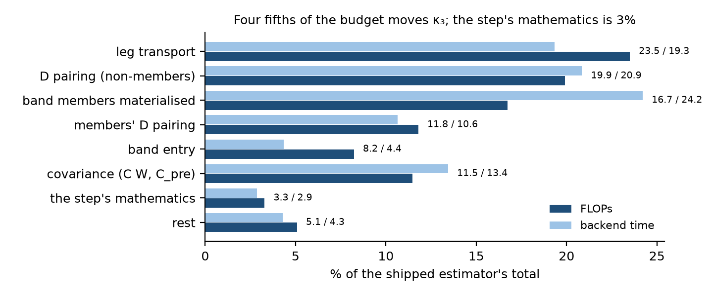
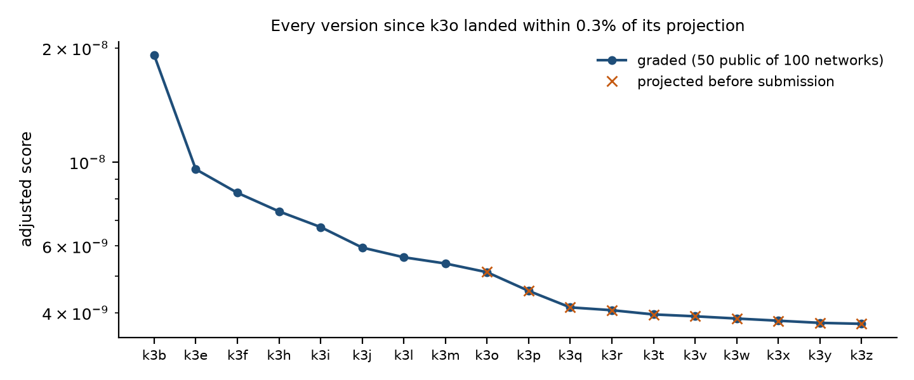
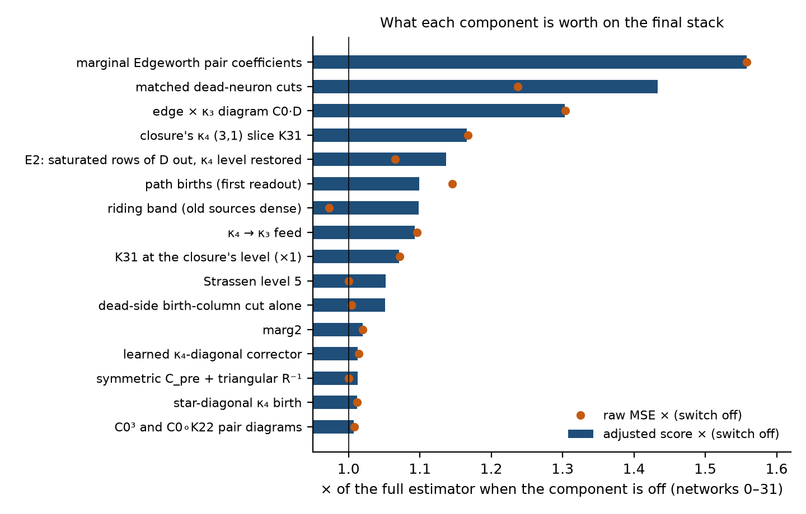
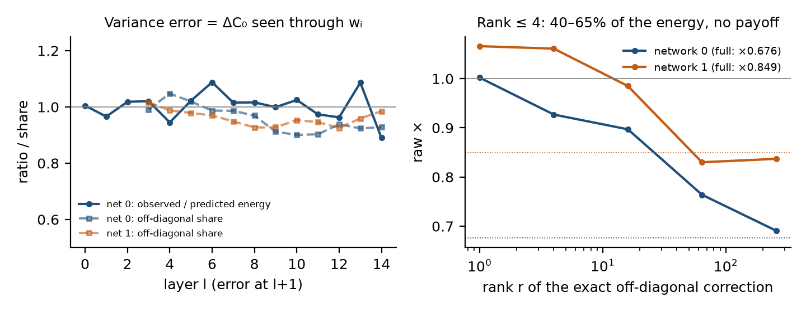

# A third-cumulant chain at its boundary: consistency, random projections, the price of carrying κ₃, and where the next order's accuracy lives

*ARC White-Box Estimation Challenge 2026 — Phase 2 — Algorithmic Contribution write-up.*
*Participant: **Artyom Kuznetsov** (AIcrowd `Artyom_Mazur`). Designated submission: **333534**, graded
**3.7357e-9** (final-layer MSE 2.0317e-8 at 18.33% of the FLOP budget; 0 failures on all 100 grader networks).*
*Claim labels: **[M]** measured in a logged run · **[D]** derived algebraically · **[U]** our interpretation, not isolated
by an intervention. The use of language models in this work is described in §9.*
*Revised 27 October 2026, after the close: board numbers of the close (§4, §6.2, §7, §8), the release links (§10), one
new measurement in §6.4 (the error along the mean) and later forum work that extends these results (§6.4, §7). The
version posted on 16 October is otherwise unchanged.*

---

## Summary

**Task and result.** Predict the per-neuron mean post-ReLU activation of every layer of a random He-initialised ReLU
network (width 1024, depth 16, Gaussian input) within 2⁴¹ analytical FLOPs; the score is the final-layer MSE times
max(0.1, FLOPs/budget). Our estimator is a cumulant-propagation chain closed at the third cumulant. Its skeleton is the
SIMPLE k = 3 algorithm of Wu et al. (arXiv:2605.05179) and their MIT reference implementation, re-derived and
re-implemented from scratch (§3.1); everything else in §3 is ours unless a credit says otherwise. The designated
submission scores 3.7357e-9: ×108 better than covariance propagation, ×2.1 more accurate than the reference algorithm at
×8 less compute. It is the last of ten consecutive versions that
each landed within 0.3% of their pre-submission projection (§5.1).

**What we would like judged.** Six measured statements about why this family of estimators behaves as it does. Each
is stated as a rule with the prediction it makes, and each is backed by an oracle-substitution or a metered measurement
rather than by an argument.

1. **The next layer's per-neuron errors are random projections of this layer's joint errors** (§6.4, Proposition 1).
   ΔC(l), the error of the chain's post-activation covariance, is independent of W(l+1), so the variance error of
   neuron i is wᵢᵀΔC wᵢ: a coherent level from tr ΔC plus independent noise across neurons set by the off-diagonal
   part. Verified against 10⁷-sample covariance oracles (predicted/measured 0.89–1.09; 95% of the energy is
   off-diagonal). The κ₃ error is an odd-order projection and has no coherent level at all (Proposition 2; z² = 0.93
   over 28 layer–network pairs), and the real columns' errors are spread exactly like the chain's errors along random
   directions independent of the network (spread ratios 0.96–1.12 and equal means over four layers of two networks). This is why every corrector of a neuron's moments from its own state failed on our
   chain: the part of the error such a model can see is worth ×1.0; the part it cannot is worth ×0.3. What a per-neuron
   correction can learn is set by the truncation order, not by depth: about two thirds of a Gaussian closure's error at
   every shape from 256 × 8 to 1024 × 16, ≤ 4% of a k = 3 chain's, because a neuron's true κ₃ is proportional to its
   own mean: the slope at every layer is the projection of the post-activation partial trace on the mean (exact in
   expectation, confirmed to ~1%), its first value is derived (c(1)·n = 13.91, measured 13.94), and carried inside a
   Gaussian closure the law removes exactly the learnable part (§6.4). `scripts/error_anatomy.py` measures this for any estimator from its outputs.
2. **The third cumulant is not closed on the two slices the nonlinear step reads** (§6.2). The all-distinct part of κ₃
   is 28.8% of the next layer's diagonal per layer, orthogonal to everything computable in O(n²), and ×25.6 end to end
   without it. κ₄ can be closed in O(n²) because it enters the readout at second order; κ₃ is the readout. The 28.8% is
   derived, not only measured (Proposition 3: share² = 6‖G<sub>AD</sub>‖² / (6‖G‖² + 9‖v‖²), measured/predicted 1.00 ± 0.06 at
   n = 256), and it falls only slowly with width. Independently replicated by team 504aldo (forum 18218) with different
   code and a different instrument.
3. **The construction costs what it saves** (§6.1). Five compressions of the κ₃ state, each affordable by a cost model
   that priced the saved product, each dead on the meter when the construction of the compressed object was priced:
   the basis, the fit, the rotation, the entry. The one compression that ships (§3.6) is the one whose basis is never
   rebuilt. The rule predicts the fate of compressions we never tried.
4. **Consistency: the chain's errors compensate, so remove a term on both sides or not at all** (§3.5, §2c). Three
   changes that removed computation and gained accuracy (matched dead-neuron cuts, saturated rows of D with the κ₄
   level they carried restored, one Edgeworth coefficient dropped in all three pair channels); and the mirror image
   from the oracle side: exact variance alone can make the result worse (×1.09), exact variance, κ₃ and κ₄ together
   give ×0.12.
5. **One order up: the missing accuracy is the young fourth cumulant, and we can say which trees** (§7). At small width
   ARC's k = 4 is ×3–7 better than our chain; its gain lives in the κ₄ born in the last two layers, above all in the
   graph that hands the whole third cumulant on through one covariance edge (the "3+2" tree; without it the young κ₄ is
   worse than none). Inside ARC's own k = 4, three layers of κ₄ blocks plus one scale-mixture block for the rest keep
   89% of its gain over k = 3 at 256 × 16 for 0.4 of the κ₄ columns (§7.3). A reader of those trees built from our
   chain's own state cuts our raw error to ×0.70 on all ten
   full-width test networks, close to the leaders' raw error; metered in our representation, it costs about what it buys (×0.97 in
   score at best), so it is not in the designated submission. The one variant we did port, to measure it on the
   grader, is ×0.92 raw on the hundred public networks at +5% FLOPs, and the grader zeroed 16 of them for residual
   time: the construction is priced in metered calls as well as in FLOPs (§7.4).
6. **The instrument has a resolution** (§6.5): a lever worth under 2–3% cannot be validated by a submission, and a
   scalar fitted on ten networks arrives at a third of its strength on a hundred. Structural levers transfer; the ten
   ports that landed on their projections are the evidence.

**The method, briefly** (§3; ablation on 32 fresh networks in §5.2). A κ₄ closure in O(n²) from the Gaussian scale
mixture (κ₄ᵢ ∝ varᵢ², K22 ∝ varᵢvarⱼ + 2C0ᵢⱼ²), which pays only together with the edge × κ₃ diagram C0·D that the
reference truncates (together ×1.136; each alone ≤ ×1.07 or harmful; on the final stack ×1.30 and ×1.17 when removed);
the rest of the first-order scale-mixture set, including a κ₄ → κ₃ feed; the augmented path births where they are cheap;
the consistency cuts of item 4; old sources in a rank-448 basis that rides the transport (×0.893, 100/100 networks); one
learned correction of the κ₄ diagonal from O(n²) row reductions of matrices the chain already holds (the idea is
mliston's, forum 18170; ×0.988 out of sample and ×0.988 on the grader); and exact arithmetic — Strassen–Winograd as
flopscope operations, symmetric and triangular savings — which we report in Appendix A because it is engineering.

**What we did not achieve.** The top of the board is ×1.5–1.8 more accurate and ×1.5–1.8 cheaper than this method, by
means that are not published. Item 5 explains the accuracy; the cheaper base the leaders must have for the κ₃ state is
the part we did not find, and §6.1–§6.2 say why none of the constructions we could price gives it. §8 lists what we
would try next.

**How this document was made.** Every number comes from a logged run with a self-check (§1); the journal of the work,
including seventy-six catalogued negative results with their mechanisms, is released with the code (§10). The
participant directed the research and Claude Code wrote the code and the drafts under that direction; §9 states the
division of labour and the errors the model made.


## 1. Setting, metric and harness

**Task.** Layer *l* computes y<sup>(l)</sup> = ReLU(W<sup>(l)</sup>ᵀ y<sup>(l−1)</sup>) with W<sup>(l)</sup> ∼ N(0, 2/n) i.i.d., width n = 1024,
depth L = 16, and input y<sup>(−1)</sup> ∼ N(0, I<sub>n</sub>). The estimator returns E[y<sup>(l)</sup>] for every layer. The score is the final-layer MSE against an
N = 10⁹ Monte-Carlo ground truth, times `max(0.1, C/B)`, with `C` the FLOPs billed by flopscope and `B = 2⁴¹`, averaged
over networks. All arithmetic goes through `flopscope.numpy`; the grader zeroes a network's prediction if its
non-flopscope ("residual") time exceeds 0.4 s, its wall time 120 s, or its memory 8 GB (Appendix A.2).

**Notation.** For a pre-activation `z` with mean μ and covariance C: σᵢ = √Cᵢᵢ, αᵢ = μᵢ/σᵢ, and under the Gaussian
closure d₁ = E[ReLU′(zᵢ)] = Φ(αᵢ), d₂ = E[ReLU″(zᵢ)] = φ(αᵢ)/σᵢ. C0 is C with its diagonal removed; t = κ₃ᵢᵢᵢ;
D = κ₃ᵢᵢⱼ (the (2,1) slice); K22 = κ₄ᵢᵢⱼⱼ. "Raw" means the final-layer MSE; "util" means C/B.

**The baseline everyone starts from** is covariance propagation ("k = 2": the linear step exact, a Gaussian closure at
every ReLU): raw 4.05e-6 at 2.35% of the budget on the 100 public networks, i.e. adjusted 4.05e-7. Plain sampling at the
same metric bottoms out near 1.2e-6. The method of §3 reaches raw 2.03e-8 at 18.3% of the budget (adjusted 3.74e-9) —
200× more accurate than covariance propagation.

**Harness and discipline.** Every number in this document is a logged measurement against the baked 10⁹ ground truth
of the public `mini` split (100 networks) unless it is labelled otherwise. Three instruments are used:

- the **production estimator** under the official runner (`whest run`), which gives exact FLOPs and the score;
- a **float64 research chain** in torch with every term as a switch, used for ablations and oracle substitutions
  (it reproduces ARC's reference implementation slice by slice to 1e-15, and the production estimator to ≤1e-6);
- **Monte-Carlo oracles** of the chain's intermediate state (per-neuron moments, the full post-activation covariance,
  the (2,1) slice) at 10⁷ samples with two independent seeds, so that an oracle's own noise is measured and
  subtracted rather than assumed away.

Every switch, when off, reproduces its predecessor bitwise (production) or to float rounding (research chain); every
new measurement harness is first gated on a number it must reproduce. Those gates caught, among others, a
double-applied ReLU gate, a wrong layer's weight matrix in a delegated analysis (a bogus 138% effect), unstandardised
regression features, and a float64 overflow at dead neurons — each before it could become a claim. We use **[M]** for
a measured claim, **[D]** for one derived algebraically or computed from measured numbers, and **[U]** for our
interpretation where an intervention has not isolated it.

**Two machines.** Most measurements ran on one laptop; long batch jobs (oracles, catalogue screens) ran in Claude Code
cloud sessions with the same pinned code. FLOP counts and MSEs agree between the two to the printed digit; wall and
residual times do not transfer, so every timing decision was taken on the laptop and confirmed from the grader's own
telemetry, which every submission page publishes.


## 2. Where the error lives

Every design decision in §3 and every closure in §6 was made against an **oracle-substitution** measurement: run the
chain, and at chosen layers replace one quantity of its state by its Monte-Carlo value (10⁷ samples, two independent
seeds so that the oracle's own noise can be measured and subtracted), then see what that is worth on the final layer.
The measurements below are the ones the rest of the document leans on. All are upper bounds on what *any* method
could gain through the substituted quantity, and we label them as such.

**(a) The Gaussian-closure error is a mean error, and the parts of the state multiply [M].** Covariance propagation
(the linear step exact, a Gaussian closure at every ReLU) has raw error 5.15e-6 on our first three networks. Injecting
exact quantities into it, one at a time and together (Part I of this project, `state_split3`):

| upstream mean | upstream covariance | Edgeworth readout | final-layer MSE | vs k = 2 |
|---|---|---|---|---|
| chain's | chain's | no | 5.15e-6 | 1× |
| exact | chain's | no | 2.22e-7 | 23× |
| exact | chain's | yes | 1.84e-7 | 28× |
| k = 3 chain's | k = 3 chain's | yes | 6.41e-8 | 80× |
| exact | k = 3 chain's | yes | 2.94e-8 | **175×** |

A perfect final readout alone is worth 1.08× on a bad state and 3.8× on a good one: no component can be judged in
isolation, and the third cumulant's job is to get the *propagated means* right.

**(b) The remaining error is born in the kink core of every layer, not in the tails [M].** On the current chain,
substituting exact post-activation means for one activation regime at a time (ten networks; a cloud session):
dead neurons (α = μ/σ < −2.5) ×0.995, saturated ×0.49, the kink ×0.21, all ×0.21; inside the kink, the core
(|α| < 1) ×0.34, the saturating shoulder ×0.52, the dead shoulder ×0.93. About four fifths of the final error travels
through intermediate means and is born **where the ReLU is most nonlinear and the Edgeworth series most reliable**:
fed exact moments, our first-order readout is accurate to ~1e-12 of the layer MSE in both tails and ~1e-10 in the kink.
The tails, which the Phase-1 literature and our own first hypothesis blamed, hold none of it; a 149-arm screen of
tail-term restrictions found nothing beyond §3.5's consistency fixes.

<figure><figcaption>Figure 1. Oracle substitution of exact post-activation means, one activation regime at a time (ten networks, ×  of the chain's final-layer MSE). The dead regime holds nothing; the kink core, where the ReLU is most nonlinear, holds most of the error.</figcaption></figure>

**(c) The channels only work together [M].** Exact pre-activation moments of the kink neurons substituted at every
layer: variance alone ×0.64 / ×0.82 (two networks), κ₄ alone ×0.78, κ₃ alone ×0.88 — and **all three at once ×0.12 /
×0.13**. Exact variance alone is even *harmful* on one network (×1.09 when substituted for all neurons). The chain's
errors in its channels are mutually consistent, and a correction of one channel breaks that consistency; this is the
same phenomenon as §3.5 seen from the oracle side, and it is the reason §3.7's corrector touches one channel only.

**(d) What the per-neuron errors are made of [M + D].** §6.4 proves and measures that the next layer's per-neuron
variance error is, 95% of it, a random projection of the off-diagonal post-covariance error through the next layer's
independent weights — the reason every learned per-neuron correction of the variance failed, and the reason the
oracle reserve of (c), real as it is, is out of reach of anything cheap.

So the target is sharply posed: the error is in the per-neuron moments of kink-core neurons, it is jointly
consistent across channels, and its rough part is a projection of joint-cumulant errors. §3 is what we could fix
within that; §6 is why the rest resists.


## 3. The method

The estimator is a cumulant-propagation chain closed at the third cumulant. **Its skeleton is the SIMPLE k = 3
algorithm of Wu et al. (arXiv:2605.05179) and their MIT reference implementation `mlp_cumulant_propagation`**, which we
re-derived from the paper and re-implemented from scratch for flopscope; §3.1 states exactly what we took. Everything
after §3.1 is ours unless a credit says otherwise. Every component is a constructor switch, and switching it off
reproduces its predecessor: bitwise in the production estimator, and to float rounding (≤ 1e-6) against the float64
research chain. Each subsection ends with the graded submission that first shipped it.

| step | component (section) | 100 public MLPs, local | graded (50 public of 100) | util |
|---|---|---|---|---|
| k3b | the reference chain in our source representation + workspace Strassen (3.1) | 1.98e-8 | 1.915e-8 (331962) | 55.9% |
| k3e | scale-mixture κ₄ closure + the C0·D diagram (3.2) | 9.76e-9 | 9.562e-9 (332066) | 32.3% |
| k3f | the rest of the first-order scale-mixture set (3.3) | 8.59e-9 | 8.286e-9 (332128) | 32.4% |
| k3h | Strassen level 4 through sum-of-products pairings (A.1) | 7.67e-9 | 7.401e-9 (332142) | 28.9% |
| k3i | the augmented term set where it is cheap (3.4) | 6.92e-9 | 6.728e-9 (332170) | 29.8% |
| k3j → k3m | dead rows out of every contraction (3.5) | 5.52e-9 | 5.3906e-9 (332403) | 24.8% |
| k3o | the matched dead-side row + column cut (3.5) | 5.25e-9 | 5.1127e-9 (333028) | 23.8% |
| k3p | old sources in a basis that rides the transport (3.6) | 4.68e-9 | 4.5644e-9 (333029) | 20.7% |
| k3q | saturated rows out of D, κ₄ level restored — E2 (3.5) | 4.24e-9 | 4.1279e-9 (333276) | 19.7% |
| k3r | marg2, the pair expansion's one k = 2 defect (3.5) | 4.17e-9 | 4.0579e-9 (333307) | 19.7% |
| k3t | Strassen level 5 on three contractions (A.1) | 4.06e-9 | 3.9554e-9 (333357) | 19.2% |
| k3v | the learned κ₄-diagonal corrector (3.7) | (87 fresh MLPs ×0.988) | 3.9102e-9 (333368) | 19.3% |
| k3w, k3x | level 5 on two more contractions (A.1) | 3.90e-9 | 3.8069e-9 (333398) | 18.7% |
| k3y | symmetric C_pre, explicit triangular R⁻¹ (A.1) | 3.85e-9 | 3.7573e-9 (333402) | 18.4% |
| **k3z** | **Winograd's 15-addition form; level 5 inside the C_pre halves (A.1)** | **3.83e-9** | **3.7357e-9 (333534)** | **18.3%** |

**Algorithm 1 — one layer of the designated estimator, with the subsection of each line.** State carried from layer
l−1: the post-activation mean μ and covariance C; the young κ₃ sources s = (A_s, B_s, H_s, g_s); the old ones as
coefficients Z_s in the band basis P; the post-activation κ₄ diagonal and (2,2) level.

```
1  μ ← Wᵀμ;  C_pre ← Wᵀ(CW);  var = diag C_pre;  C0 = C_pre − diag(var);
   α = μ/√var                                                          §3.1
2  dead neurons (α < −2.5) leave every contraction; the young legs and Pᵀ
   move one layer: Xᵀ ← (gated Xᵀ)·W                              §3.5, §3.6
3  the old sources' legs, materialised: (A, B) = P·(Z_A, Z_B)               §3.6
4  read κ₃: tᵢ = 3 Σ_s Σ_p g_p A_ip B_ip² + thin, feed and path terms;
   D = Σ_s (L1·Bᵀ + L2·Aᵀ) + …; rows of D with α > 2.5 removed and the κ₄
   level they carried restored by one matrix–vector product       §3.1, §3.5
5  close κ₄ in O(n²): level v from sum and trace identities;
   κ₄ᵢᵢᵢᵢ = 3v·varᵢ² (+ the newest source's star birth, + the learned
   correction at layers 8–14);  K22 = v(varᵢvarⱼ + 2C0ᵢⱼ²);
   K31 = 0.65·3v·varᵢC0ᵢⱼ                                          §3.2–§3.4, §3.7
6  the ReLU step: power moments with Edgeworth terms in (t, κ₄); pair
   power cumulants with the C0·D, K31, C0³, C0∘K22 diagrams and the marg2
   coefficients; Leonov–Shiryaev → post-activation μ (layer l's output)
   and C                                                           §3.1–§3.5
7  the source that reaches age 5 enters the band: Z = R⁻¹QᵀX, P = QR   §3.6
8  birth: hubs = neurons with α ≥ −2.5; B = diag(d₁)·C0 on those columns;
   g = d₂; correction leg = column rescaling of B + rank-24 thin leg;
   the path leg, read once at the next layer                       §3.1, §3.4
```

### 3.1 What we took from the reference, and the representation we put it in

**Taken from Wu et al. (credit, not contribution).** The linear step is exact: μ ← Wᵀμ, C ← WᵀCW, and every factor
of κ₃ is multiplied by Wᵀ. At each ReLU, with w(k,p) = E[∂ᵏ ReLU(Z)ᵖ] for Z ~ N(μᵢ, σᵢ²): single-index power
moments with Edgeworth terms, P_p = w(0,p) + w(3,p)·t/6 + w(4,p)·κ₄ᵢᵢᵢᵢ/24 with t = κ₃ᵢᵢᵢ; pair power cumulants
Q(p,q) = a₁b₁C0 + ½a₁b₂Dᵀ + ½a₂b₁D + ½a₂b₂C0² + ¼a₂b₂K22 (a_k = w(k,p)ᵢ, b_k = w(k,q)ⱼ, C0 the covariance without its
diagonal, D = κ₃ᵢᵢⱼ, K22 = κ₄ᵢᵢⱼⱼ), converted to cumulants by Leonov–Shiryaev; a third-cumulant birth at every
layer (the tree diagram Sym(U ⊗ 3I ⊗ U·diag(d₂)), U = diag(d₁)C0, plus a correction block that makes the repeated-
index slices exact); and a one-step Edgeworth readout of the post-ReLU mean. The reference keeps κ₄ as one radial
scalar. It reaches raw MSE 4.25e-8 on our first three networks at 148% of the budget; our re-implementation reproduces
every slice of it to 1e-15 [M].

**Our representation: sources, and only the slices the step reads.** Each birth at layer m creates a *source*: a hub leg A (the transport since birth; the identity at birth), a tree leg
B = A·U, a correction leg, and a fixed hub weight g = d₂ at birth. The κ₃ tensor is never formed. The next step reads only its diagonal t and its (2,1) slice D, so
only those are built:

    t_i = 3 Σ_s Σ_p g_p A_ip B_ip² + (correction-leg terms),      D = Σ_s [L1·Bᵀ + L2·Aᵀ + (thin terms)],
    L1 = 2 A∘B∘g,  L2 = B²∘g + …

After each step every leg row is gated by d₁. The correction leg splits **exactly** into a column rescaling of the tree
leg, 3B·diag(α) with α = w(1,2) − 2P₁d₁, which is free because it survives transport unchanged, and a remainder that is
numerically low-rank, carried as a thin leg of rank 24 found by a seeded randomized range finder (×1.004 against the
exact split; R dropped entirely costs ×10.5) [M]. Every per-source operation is one batched flopscope call per layer
into preallocated buffers; that is what keeps the non-flopscope ("residual") time under the grader's 0.4 s cap.

### 3.2 A closure that makes the fourth cumulant free — and the diagram it needs

The fourth cumulant enters the readout and the pair cumulants. Transporting its (2,2) structure ("memo22": the direct
pairings of Wsqᵀ(K22 + diag K4)Wsq, Wsq = W∘W) beats the reference's radial scalar (3.75e-8 against 4.25e-8, 3/3
networks) but costs two dense products per layer and gets the per-neuron **pattern** wrong (correlation with a
Monte-Carlo oracle 0.23–0.53) [M]. Two findings replace it.

**(a) The missing per-step diagram.** Fed exact (Monte-Carlo) inputs, the SIMPLE step loses 2.3 / 3.5 / 4.5% of the
post-ReLU (2,2) level at layers 6 / 10 / 14. The missing term is the cross term of the joint Edgeworth exponent between
the edge C0 and the κ₃ (2,1) slice:

    Q(p,q) += ½ (a₂b₃ Dᵀ + a₃b₂ D) ∘ C0,

and with it the step returns 0.999 / 0.999 / 1.004 of the oracle (correlation 0.974 → 0.999) [M]. It costs O(n²).

**(b) The closure.** For a Gaussian scale mixture, κ₄ᵢ = 3v·σᵢ⁴; the oracle's κ₄ᵢ correlates 0.86 with σᵢ⁴ at depth.
So we keep **one scalar v per layer** and set

    κ₄ᵢᵢᵢᵢ = 3v·varᵢ²,      K22ᵢⱼ = v·(varᵢ varⱼ + 2C0ᵢⱼ²)

(the scale-mixture forms), with v obtained in O(n²) from the exact identities sum(M) = uᵀXu and tr(M) = Σ X_ab G_ab
(u = Wsq·1, G = Wsq Wsqᵀ with an exact diagonal and a mean-field off-diagonal), which reproduce the transported levels
to four digits. The two dense κ₄ products per layer are gone [M].

**They only pay together.** C0·D on the memo22
chain is *worse* (4.64e-8 against 3.75e-8, three networks); the closure alone is ×1.07; together, with the closure's
K22 pattern, ×1.136 on ten networks (3.52e-8 → 3.10e-8), better on 9/10, at −2% of the budget [M]. With the wrong
pattern, raising the κ₄ level by the correct diagram makes the error larger; with the right pattern it removes it.
→ **k3e, graded 9.562e-9.**

### 3.3 The rest of the first-order scale-mixture set

With the closure in place, the scale mixture predicts three more first-order terms, and again **they only pay
together** (each alone is neutral or harmful) [M]: the marginal Edgeworth correction of the pair Wick coefficients,
a_k → w(k,p) + w(k+3,p)·t/6 + w(k+4,p)·κ₄/24; the closure's κ₄ (3,1) slice, κ₄ᵢᵢᵢⱼ = 3v·varᵢ·C0ᵢⱼ, entering Q as
⅙(a₃b₁K31 + a₁b₃K31ᵀ) (together with the marginal coefficients it cuts the one-step covariance error 0.3% → 0.1%); and
the **κ₄ → κ₃ feed**: all-distinct κ₃ births from the closure's (2,1,1) slice, which in the source representation is
Sym(h ⊗ D1C0D1) with h = (v/2)·d₂∘var and rides the existing products (`t += 3 m∘q`, `D += 2 diag(m) B diag(d₁) Aᵀ + q mᵀ`
with O(n²) extras). The contracted feed matches Monte-Carlo at correlation 0.97–0.98. **The κ₄ → κ₃ channel was named
as the main lever of 504aldo's public chain (AIcrowd forum 18218); our form is derived from the closure.** Ten networks
3.15e-8 → 2.80e-8 (10/10); 100 networks ×0.880, 100/100 better [M]. → **k3f, graded 8.286e-9.**

### 3.4 The augmented term set, where it is cheap

Wu et al. also give an "augmented" algorithm; their reference in that mode is ×1.3 more accurate than k3f on our first
two networks at ≈2.4× SIMPLE's cost. Against the oracle its κ₃ diagonal is exact to the oracle's noise, while its κ₄
diagonal is *not* better than our σ⁴ closure (correlation 0.87 vs 0.86), so the lever is the κ₃ step [M]. We took the
part of it that is cheap in our representation: every (1,1,1) "path" birth whose other edge is C0 shares the hub and
tree legs, so all of them together are **one extra leg** Sym(T·Y ⊗ 3A ⊗ B) with
Y = d₁Dᵀd₃ + d₂Dd₂ + ½d₂K22d₃ + d₂C0²d₃ (checked against the reference code to 5e-16), and only its **first readout** matters (age ≤ 1 keeps ~90% of the all-ages gain), so it costs one product per layer; plus the star-diagonal κ₄ birth
of the newest source (O(n²)) and the two augmented pair diagrams we lacked, ⅙a₃b₃C0³ and ¼a₃b₃C0∘K22 (O(n²)). Ten
networks ×1.145 (10/10); 100 networks 98/100 better [M]. → **k3i, graded 6.728e-9.** One level of the closure was then
set to a consistent truncation rather than fitted: the closure's K31 sits at 0.74–0.78 of the oracle, the augmented reference, a consistent truncation, at 0.54, and the chain's optimum is a flat 0.6–0.7 (×0.65 shipped; 98/100) [M].

### 3.5 Consistency: remove a term on both sides, or not at all

This principle moved the score most in the last week of the work. A neuron that the chain treats as absent on one
axis must be treated as absent on every axis it appears on; a term whose input is unreliable should go with that
input. Its Phase-1 precursor is hyojun_kwon's finding that a learned one-step operator 40% more accurate than the
Gaussian closure diverges when iterated, because the closure's value is that it is a stable iterate (AIcrowd forum
topic 18154); what follows is the same phenomenon seen from the side of removing terms. Three instances, each **an accuracy gain obtained by removing computation** [M]:

- **Dead neurons.** A neuron with α = μ/σ < −2.5 has d₁ ≈ 0, so every leg row for it is ≈ 0 after gating: we zero those
  rows exactly and run the next transport over alive rows only (rectangular Strassen, padded to the recursion's
  quantum): util 26.3% → 24.8% for +1.4% raw (k3m, graded 5.3906e-9). The transpose of that cut, the dead-side
  **birth columns** of every new source, is also removable exactly, and the two cuts must match: the matched row +
  column cut beats the row-only cut at every one of five thresholds, by a margin that grows with the gated fraction
  (matched/row = 0.9985, 0.9970, 0.9928, 0.9790, 0.9475 at −3.0 … −2.0). Production needs per-source column widths, so
  the legs are stored **transposed**, as one wide stack of hub rows, which turns the transport into one row-stack
  product and the D pairing into one contraction. 100 networks ×0.950 adjusted, **100/100** (k3o, graded 5.1127e-9).
- **Saturated rows of D (E2).** Rows of D for neurons saturated now (α > 2.5) reach the step only through the tail
  coefficients coef(2,1) = d₂ + d₅t/6 + d₆κ₄/24, whose Edgeworth correction is −28 … −79% of d₂ there; the marginal series is at the edge of validity. Removing those rows naively costs ×1.34 at 2.5, and **all** of that damage is the
  κ₄ level the next layer reads through Ssum = uᵀK22u; restoring that level by a matrix-vector product
  (dS = Σᵢ uᵢ cf22ᵢ (D v)ᵢ) turns the cut into an accuracy **gain**: raw ×0.943 (k3q, graded 4.1279e-9).
- **marg2, the pair expansion's one defect.** Keeping the marginal correction of the k = 2 Wick coefficient only in
  the dead tail (α ≤ −2) and using the plain Gaussian w(2,p) elsewhere (in Q11, Q21 *and* Q22 together; in one power
  cumulant alone it is ×1.09–1.11 worse) is worth ×0.984 on 32 fresh networks (cloud session #9A) and ×0.981 on ten
  locally, at zero FLOPs (k3r, graded 4.0579e-9). A later generative screen of seven next-order pair diagrams found
  exactly two that help, C0·K31 and D², and both are **substitutes** for marg2 (×1.008 together with it): the pair
  expansion has one defect, in its k = 2 leg, and marg2 is its cleanest form.

### 3.6 Old sources in a basis that rides the transport

Sources older than a0 = 5 layers no longer carry their own legs. They live as P·Z in one shared basis P (n × 448):
Pᵀ rides the leg transport as 448 extra rows (gated and contracted over alive rows like any leg), and since
Wᵀdiag(d₁)(PZ) = (Wᵀdiag(d₁)P)Z the coefficients Z **never change**. A source enters once, projected on the current P
through a QR (Z = R⁻¹QᵀX); P is never re-orthonormalised and Z never rotated. The members are materialised each layer
by one product for the readout, and their part of D is paired in the compressed space, (L_mᵀ Zᵀ)Pᵀ. 100 networks
×0.893 adjusted, **100/100** better (k3p, graded 4.5644e-9) [M]. Both band knobs sit at sharp optima (rank 320 / 384 /
448 / 512: ×1.228 / 1.032 / 1 / 1.033; entry age 4 / 5 / 6: ×1.125 / 1 / 1.016) [M]. Why this compression works where
the re-fitted subspace of §6.1 did not is the subject of that section: the basis is never rebuilt.

### 3.7 A learned correction of the κ₄ diagonal

**The idea is mliston's** (AIcrowd forum 18170, Phase 1): a model trained offline on self-generated networks to predict
the closure's error from its own propagating state, frozen into the estimator as constants. No code of theirs was seen
or used. Our version and what we learned testing it:

- From the neuron's **own** moments the damaging error is invisible (§6.4); the κ₄ diagonal is the exception because
  its error has an environment-dependent level, which **O(n²) row reductions of matrices the chain already holds**, C0, D and K22, can see. The model is a ridge regression (λ = 1e-3) of the relative κ₄ error on 39 features
  (21 functions of the neuron's own moments, 17 such row reductions, the layer index), applied at layers 8–14 with
  shrinkage 0.5 (not tuned); 118 numbers, trained on the production trajectory of 10 public networks against our own
  Monte-Carlo oracles (two at 10⁷ samples, eight at 2·10⁶).
- **Two networks are not enough** (fit on one, apply to the other: ×1.00–1.08); ten are, and thirty are not better
  (held-out R² 0.353 vs 0.354) [M].
- **The validation ladder**, each step less optimistic than the one above it [M]: in sample ×0.92 → ten-fold leave-one-
  network-out ×0.974 → online ×0.968 → through the production estimator ×0.980 → **87 networks never seen ×0.988
  (69/87)** → **the grader ×0.988** (raw 2.0559e-8 → 2.0312e-8).
- The same construction for the variance or κ₃ **hurts**, in sample and out (§6.4). → **k3v, graded 3.9102e-9.**

### 3.8 Exact arithmetic

Strassen–Winograd as flopscope operations (deepened only where a contraction pays for its wall time), the symmetric
C_pre computed as three blocks of four, an explicit triangular inverse where flopscope bills `solve` as an LU, and
Winograd's 15-addition form change the FLOP bill and move the output only by float rounding. They are engineering, and
they are in Appendix A.1 with their measurements; here only the record: k3t, k3w, k3x, k3y and k3z together are ×0.931 of
the ×0.693 from 5.39e-9 to 3.74e-9, and each landed on the grader as projected [M].


## 4. Cost: where the budget goes, and what binds it

The score is `mean_m( final_layer_mse_m × max(0.1, C_m/B) )` with `B = 2⁴¹` FLOPs per network as billed by flopscope.
Two features of that formula shaped every decision in §3.

**It is a product, so relative percentages are interchangeable.** At our operating point 1% of utilisation and 1% of
MSE are worth exactly the same, which is why every lever in this document is reported as a pair (raw ×, util ×) and why
several terms that *improve accuracy* are absent from the shipped estimator: they improve it by less than they cost.

**The multiplier floors at 0.1.** Above 10% of the budget every FLOP is charged linearly; at or below it FLOPs are free
and only accuracy matters. We never got under the floor (k3z: 18.33%). At our raw error, the floor alone would have
been worth ×0.55: 2.03e-9, 16th place on the final board of 21 October, and §6.1–6.2 are the record of
why it could not be reached with this representation.

### 4.1 The measured cost map of the shipped estimator

We stopped pricing levers with a cost model after it was wrong by 3.5×, by 9× and in sign within one day (§6.1 records
what that model said yes to). The map below is the meter itself: the shipped estimator with a `flopscope.namespace`
around every call site (a copy verified bitwise against the shipped file), run through the official runner on one
public network [M]:

| call site | what it is | FLOPs | backend time |
|---|---|---|---|
| leg transport | the young sources' legs and the band basis Pᵀ moved one layer (Strassen level 5) | **23.5%** | 19.3% |
| D pairing | the (2,1) slice from the non-members' legs (level 5) | **19.9%** | 20.9% |
| band members | the old sources' legs materialised from the basis, for the readout (level 5) | **16.7%** | **24.2%** |
| members' pairing | the old sources' part of D, paired in the compressed space (level 4) | 11.8% | 10.6% |
| band entry | QR of the basis, projection, explicit triangular inverse | 8.2% | 4.4% |
| covariance | C and the newest path leg transported (level 5), C_pre = Wᵀ(CW) (3 of 4 blocks, level 5) | 11.5% | 13.4% |
| the step's mathematics | the whole pair expansion **0.43%**, the κ₄ closure 0.06%, its learned corrector 0.05%, the readout 1.9%, the births 0.9% | **3.3%** | 2.9% |
| the rest | pairing preparation, thin legs, the E2 level restoration, gathers and gating | 5.1% | 4.3% |

<figure><figcaption>Figure 2. The table as a picture: share of the designated estimator's FLOPs (dark) and of flopscope's backend time (light) by call site, one network, <code>flopscope.namespace()</code> on a bitwise copy of k3z.</figcaption></figure>

**Four fifths of the budget is the logistics of carrying the third cumulant forward; the mathematics that decides the
answer is 3%.** Two consequences follow, and both shaped the work. Any accuracy term that lives in the step, such as a new pair diagram, a closure pattern or the learned corrector, is free, which is why §3.2–§3.5 and §3.7 cost nothing
measurable. And any real cost saving has to come out of the representation of κ₃, which §6.1 and §6.2 show is the one
place no cheap construction exists. The level-5 sites run at 8–14 billed GFLOP/s against 17–30 for level-4 and
element-wise work: deeper Strassen recursion buys FLOPs with wall time.

### 4.2 The configuration sits at the kink of its own cost/accuracy curve

Eight structural knobs were measured in both directions on ten networks: the band rank and entry age, re-opening all
source ages for the path births, a larger thin rank, the κ₄ → κ₃ coupling, and others. The elasticity
|d log raw / d log util| is **below 1 in every direction that spends more** (band rank 512: 0.43; entry age 6: 0.56;
all ages: 0.25; thin rank 384: 0.10; κ₄κ₃: 0.05) and **above 1 in every direction that spends less** (rank 384: 1.54;
entry age 4: 3.76) [M]. The product raw × util is minimised exactly where the estimator ships; a fifty-three-switch
catalogue re-screened by a cloud session found no switch that improves it either (12 of 53 improve raw, none the score).

### 4.3 The budgets that are not the meter

Three caps zero a network's prediction when crossed (400 ms of non-flopscope time, 120 s of wall time, 8 GB of memory),
and in practice they, not the FLOP count, set the depth of every engineering choice. Their measurements, the Strassen
depth they allow and the designation they imply are in Appendix A.2–A.3.


## 5. Results

### 5.1 Every structural lever landed on its projection

Before shipping, every version was run on our 100 public networks with the official runner; the projection for the
grader is that local score times the measured local→grader ratio of the previous version. The last ten versions [M]:

| submission | version | what changed (§) | projected | graded | util | wall max / residual max (grader) |
|---|---|---|---|---|---|---|
| 333028 | k3o | matched dead-side cut (3.5) | 5.12e-9 | **5.1127e-9** | 23.8% | — / 0.178 s |
| 333029 | k3p | old sources in a riding basis (3.6) | 4.57e-9 | **4.5644e-9** | 20.7% | — / 0.233 s |
| 333276 | k3q | E2, the saturated rows of D (3.5) | 4.14e-9 | **4.1279e-9** | 19.7% | 63.7 s / 0.247 s |
| 333307 | k3r | marg2 (3.5) | 4.06e-9 | **4.0579e-9** | 19.7% | 69.7 s / 0.262 s |
| 333357 | k3t | level 5 on three contractions (A.1) | 3.95e-9 | **3.9554e-9** | 19.2% | 82.1 s / 0.268 s |
| 333368 | k3v | the learned κ₄ corrector (3.7) | 3.91e-9 | **3.9102e-9** | 19.3% | 81.2 s / 0.277 s |
| 333388 | k3w | level 5 on the band members (A.1) | 3.86e-9 | **3.8576e-9** | 18.9% | 92.2 s / 0.288 s |
| 333398 | k3x | level 5 on the D pairing (A.1) | 3.80e-9 | **3.8069e-9** | 18.7% | 95.2 s / 0.281 s |
| 333402 | k3y | symmetric C_pre, explicit triangular R⁻¹ (A.1) | 3.76e-9 | **3.7573e-9** | 18.4% | 97.6 s / 0.310 s |
| **333534** | **k3z** | Winograd's 15-addition form, level 5 inside the C_pre halves (A.1) | 3.735e-9 | **3.7357e-9** | **18.3%** | 98.8 s / 0.331 s |

<figure><figcaption>Figure 3. Graded score of every k = 3 version that improved our graded best (log scale), from the first graded k = 3 submission (k3b, 1.9e-8) to the designated one; crosses mark the projection made before each of the last ten submissions.</figcaption></figure>

The designated submission, **333534**, ran on all 100 grader networks (50 public, 50 sealed) with 0 failures; its
raw error is 2.0317e-8, its utilisation 18.3%, its wall time 91.2 s median and 98.8 s maximum of the 120 s cap.
Compared with the reference algorithm we started from (raw 4.25e-8 at 148% of the budget), the method is ×2.1 more
accurate at ×8 less compute; compared with covariance propagation (4.05e-7 adjusted), the score is ×108 better.

The table should be read against §6.5. A fitted scalar that improved 66 of 100 local networks came out
0.13% worse on the grader; the ten structural or exact changes above, each validated the same way, landed within
0.3% of their projections. The one learned component (k3v) behaved like a structural one because it was validated
on 87 networks it had never seen before it shipped.

### 5.2 What each component is worth on the final stack

The production estimator (k3y; the designated k3z differs from it only by exact FLOP savings) with ONE switch
turned off at a time, on public networks 0–31, and separately on 10–31, on which none of the method's fitted choices (the
corrector's training set, the cut thresholds, K31's level) was made [M]. Ratios against the switch on; each
arm is compared with a base run on the same machine (M = laptop, C = a cloud session: per-network float32 rounding
differs between the two by up to ±4%, the FLOPs by ≤3·10⁻⁶).

| switched off | § | adjusted × (0–31) | raw × | util × | networks worse | adjusted × (10–31) | run |
|---|---|---|---|---|---|---|---|
| the marginal Edgeworth pair coefficients | 3.3 | **×1.558** | ×1.558 | ×1.000 | 32/32 | ×1.547 (22/22) | M |
| the matched dead-neuron cuts (rows and birth columns) | 3.5 | **×1.433** | ×1.237 | ×1.159 | 32/32 | ×1.420 (22/22) | C |
| the edge × κ₃ diagram C0·D | 3.2 | **×1.303** | ×1.304 | ×0.999 | 32/32 | ×1.299 (22/22) | M |
| the closure's κ₄ (3,1) slice K31 | 3.3 | **×1.166** | ×1.167 | ×0.999 | 32/32 | ×1.163 (22/22) | M |
| E2: saturated rows of D out, κ₄ level restored | 3.5 | **×1.137** | ×1.065 | ×1.067 | 32/32 | ×1.138 (22/22) | M |
| the path births (augmented (1,1,1) births at the first readout) | 3.4 | **×1.099** | ×1.145 | ×0.959 | 32/32 | ×1.092 (22/22) | M |
| the riding band (old sources carried densely) | 3.6 | **×1.098** | ×0.973 | ×1.128 | 32/32 | ×1.098 (22/22) | C |
| the κ₄ → κ₃ feed | 3.3 | **×1.093** | ×1.096 | ×0.997 | 30/32 | ×1.101 (21/22) | M |
| K31 at the closure's own level (×1 instead of ×0.65) | 3.4 | **×1.071** | ×1.072 | ×1.000 | 32/32 | ×1.072 (22/22) | M |
| Strassen level 5 (level 4 everywhere) | A.1 | **×1.052** | ×1.000 | ×1.052 | 32/32 | ×1.052 (22/22) | M |
| the dead-side birth-column cut alone | 3.5 | **×1.051** | ×1.004 | ×1.048 | 31/32 | ×1.048 (22/22) | M |
| marg2 (Gaussian k = 2 pair coefficient outside the dead tail) | 3.5 | **×1.020** | ×1.020 | ×1.000 | 30/32 | ×1.020 (21/22) | M |
| the learned κ₄-diagonal corrector | 3.7 | **×1.013** | ×1.014 | ×0.999 | 23/32 | ×1.010 (15/22) | C |
| symmetric C_pre and the explicit triangular R⁻¹ | A.1 | **×1.013** | ×1.000 | ×1.013 | 32/32 | ×1.013 (22/22) | M |
| the star-diagonal κ₄ birth | 3.4 | **×1.012** | ×1.012 | ×1.000 | 24/32 | ×1.012 (16/22) | M |
| the augmented pair diagrams C0³ and C0∘K22 | 3.4 | **×1.007** | ×1.008 | ×0.999 | 24/32 | ×1.008 (19/22) | M |

<figure><figcaption>Figure 4. The table as a picture: adjusted score × (bars) and raw error × (dots) when one component is switched off, networks 0–31. The first-order scale-mixture set and the consistency cuts carry the method; the cost levers trade FLOPs for little or no accuracy.</figcaption></figure>

Three things stand out [M]. **The step's first-order scale-mixture set is the most valuable part of the method,
and it is free:** without the marginal Edgeworth pair coefficients the error is ×1.56, without the edge × κ₃
diagram C0·D ×1.30, without the closure's K31 ×1.17, all of them O(n²); then the path births ×1.10, the κ₄ → κ₃ feed
×1.09 and K31's truncation level ×1.07. On the final stack each of them is load-bearing even though, as §3 showed,
none of them paid alone when it was added: the consistency of §3.5 seen from the other end. **The consistency cuts are accuracy gains as well as savings:** with the matched dead cuts off, raw error is ×1.24 worse; with E2
off, ×1.07. **The cost levers buy FLOPs with little or no accuracy:** the riding band costs 3% of raw error and
saves 11% of the bill; level-5 Strassen and the symmetric/triangular savings change the output only by rounding.
The one learned component is worth ×1.010 out of its training sample, the value it showed on the grader
(×0.988⁻¹ = ×1.012). Every component worth more than 5% makes at least 30 of the 32 networks worse when removed,
and the 22 networks outside every fitted choice give the same ratios to the second digit.

### 5.3 Where the remaining error is

§2 and §6.4 are the answer: four fifths of the final error is born in the kink core of every layer; at depth 95% of
the next layer's variance error is a random projection of the off-diagonal covariance error through independent
weights; and the step's two pair inputs carry errors (7% in D, 20% in K22) that are worth fixing only all together.
The oracle bound for fixing every per-neuron moment at once is ×0.2–0.3 of our raw error. The representation lacks the joint structure that would make those moments right, not a
term.


## 6. The boundary: four mechanisms that decide what is possible here

We think this section and §7 are the contribution. §3 is a sequence of terms that pay; this section is a map of why
the remaining ideas do not, and the map is made of measurements. Each mechanism is stated as a rule, with the
prediction it makes about ideas we never tried. Over three weeks we catalogued seventy-six negative results with numbers
(the repository's `notes/NEGATIVE-RESULTS.md`; we cite its entries as N1–N76, which the repository's own notes write as
§1–§76); the four mechanisms below account for every one that failed for a reason more
interesting than a bug or a budget.

### 6.1 A cost model that prices the saved product and not the construction says yes every time

Every attempt below has the same shape. Some object in the chain costs `k` dense n³ products per layer. A compression
exists that would carry the same information in `q·k` products, `q < 1`. The cost model says the saving is `(1−q)·k`,
and the accuracy measurement says the compression is affordable. **Then the construction that produces the
compressed object turns out to cost at least as much as the saving.** Five independent instances, each closed by its
own measurement [M]:

| # | what was to be compressed | modelled saving | what the construction cost | net |
|---|---|---|---|---|
| N54 | old sources onto a shared subspace (band 6:320, *re-rotated every layer*) | 26.3% → 21.4% of budget, ×1.20 | the per-layer entry update (Gram applications, QR, `eigh`, coefficient rotation ≈ 4–7 products per band source-layer) | **27.78% measured, i.e. worse than the 26.62% baseline** |
| N55 | the path leg at rank ρ = 256 (`pathrank`) | −0.7 points of B for +0.66% MSE | the rank-ρ basis: `YΩ` + `QᵀY` (2q) on top of `WᵀQ` + `(WᵀQ)Z` (2q) = **4q = 1.0 units at ρ = 256**, before a `qr` worth 0.125 | break-even *before* the QR; measured on the meter at rank 384: **×1.0495 of the dense leg** |
| N58 | the old κ₃ tail as one rank-n block | 24.14% → 12.69–13.87%, ≈ **8.8 units per layer**, and a rank-n block provably **exists** (n = 64, converged to 4.29e-4) | one Gram-form fitting pass is `8·n·R·r` flops = **8.0 units**, so the budget is *one pass*; 400 passes reach 4.32% **and are still falling** | **≈400× gap**, and no warm start: adding one source to a converged block throws the error 2.9% → **48.7%**, because the CP optimum **is not nested** |
| N59 | the same block by unbiased sampling (O(n²), no passes, nested by construction) | the budget is 3–5% relative error | the estimator's own variance: relative error ≈ κ/√r with **κ = (Σ‖term‖)/‖T‖ = 62.08** | **194% at r = n**; 5% would need r ≈ 1.5·10⁶ columns against the 15 360 the tail contains |
| N76 | the old tier read through a smaller per-layer optimal basis (r′ < 448), or truncated by age, or its D taken from the young sources only | r′ = 256 would save ≈8% of the FLOPs; dropping the three oldest sources 11% of the member-layers | the content itself: reading the members in 256 dimensions costs ×1.11–1.15 raw and in 128 ×2.7–3.1; the three oldest sources dropped ×1.17; D from the young sources only ×9.25 | **the band at rank 448 and entry age 5 is the cheapest exact-enough carrier in this family** (both knobs are sharp optima, §3.6) |

The five share one cause: the accounting was incomplete. A compression has two costs, transporting the compressed
object and producing it, and only the first is what a "this would be cheaper" estimate naturally counts. The second is
paid every layer, because the object being compressed is regenerated every layer by the nonlinearity.

**The counter-example that confirms the rule.** One compression of the old sources *does* ship (§3.6): a basis of
fixed rank 448 that **rides the transport**: it is moved by the same products as the legs and never re-built,
re-rotated or re-orthonormalised, so its construction cost is paid once per source, at its entry. Its condition number
grows ≈2.5× per layer (to 7·10⁴ by the last entry) and that is harmless, because nothing ever needs it orthonormal again
[M]. The difference from N54 is exactly the term the rule says to price.

**The prediction we would hand the next person.** Before building any compression of a propagated object, price the
*basis*, per layer. For a projection onto `r` directions the basis needs at least one pass over the object (`q` units)
plus one to express the object in it (`q`), plus orthogonalisation; for a CP-type re-parameterisation it needs a
solver, and N58 shows the solver has no warm start. The saving must beat **all** of that, or the basis must ride the
transport for free.

**Budgets other than the meter.** Exact arithmetic savings obey a different rule, and we report it because the
grader enforces it. One more Strassen-Winograd level everywhere (leaf 64 → 32) bills ×0.939 of the FLOPs, changes the output by ~1e-6, and doubles the wall time (×2.2; ≈140 s projected against the 120 s cap) at a peak RSS of 7.21 GB of
8 GB (N69) [M]: a 32×32 leaf has no BLAS efficiency left. Pricing each contraction separately by **FLOPs saved per
second of wall added** (0.49 %/s for the leg transport down to 0.27 %/s for the D pairing) and deepening only where it
pays recovered most of that ×0.939 on five sites, inside the cap (grader wall 98.8 s max); the next site measured at
0.094 %/s (both of its products have a 448-wide side, so its level-5 leaves are 14 wide) and was not taken [M].

### 6.2 The principle underneath the four: the third cumulant is not closed on the slices the step reads

The four instances in §6.1 are failures of *representations*. The question that sits under all of them is whether
the κ₃ tensor needs to be represented at all, since the nonlinear step reads only two of its slices, the diagonal
t and the (2,1) slice D. We measured that directly.

With the leg transport M = Wᵀ·diag(d₁) (verified to reproduce the chain's own transport to ≤ 5.1e-16), the next
layer's diagonal splits exactly, by coincidence pattern of the three indices, into a t-term (Σ<sub>j</sub> M<sub>ij</sub>³ t<sub>j</sub>), a D-term
(3 Σ<sub>j≠k</sub> M<sub>ij</sub>² M<sub>ik</sub> D<sub>jk</sub>), and an **all-distinct** term Σ<sub>j,k,m distinct</sub> M<sub>ij</sub> M<sub>ik</sub> M<sub>im</sub> T<sub>jkm</sub>, which we obtain as a
remainder without ever forming n³ (closed forms checked against brute force to 6e-17 and 4.3e-16). Then:

| quantity | measured (n = 1024) |
|---|---|
| share of the next diagonal carried by the all-distinct term | **28.8%** per layer (layers ≥ 8; 27.2–31.2%) |
| a chain whose κ₃ state is (t, D) only, end-to-end | **raw ×25.6** (compounding: 1.288¹⁴ ≈ 34) |
| fraction of the all-distinct term a closer must capture to stay within 3% raw | **≥ 93%** |
| best oracle closer on any O(n²) basis we could construct | **19.5%** |
| of which re-fitting the t- and D-coefficients | **0.16%** — the missing part is orthogonal to both (corr ±0.03); the D-coefficient fits to 1.000 |

So a (t, D) state is insufficient, and what is missing is **orthogonal to everything computable in O(n²)**. That is a
statement one level above §6.1: the κ₃ state must carry Θ(n³) information forward, and the cost of this chain is the
price of that information. The contrast that explains why our κ₄ closure (§3.2) works and a κ₃ closure cannot is
worth one line: κ₄ enters the readout at second order, whereas κ₃ *is* the readout, so its tolerance is an order of
magnitude tighter.

**Why 28.8%, derived.** The share is not a property of our arithmetic; it follows from how the gated κ₃ tensor's
energy is spread over index patterns.

> **Proposition 3 (the share the slices do not carry).** Let G = T ∘ (d₁ ⊗ d₁ ⊗ d₁) be layer l's κ₃ tensor with the
> gates on its legs, v<sub>a</sub> = Σ<sub>b</sub> G<sub>abb</sub> its partial trace, and G<sub>AD</sub> its entries with three different indices. With
> W(l+1) i.i.d. N(0, 2/n) and independent of G, the part of the next diagonal that (t, D) do not determine has, for every
> neuron,
>
> share² = E‖AD‖² / E‖t′‖² = 6‖G<sub>AD</sub>‖²<sub>F</sub> / (6‖G‖²<sub>F</sub> + 9‖v‖²). [D]
>
> *Proof.* t′<sub>i</sub> = Σ<sub>abc</sub> w<sub>a</sub>w<sub>b</sub>w<sub>c</sub>G<sub>abc</sub> with w the i-th column of W(l+1). Isserlis' theorem for the sixth moment
> of a Gaussian vector gives 15 pairings: the 6 that match the two triples give 6s⁶‖G‖², the 9 that pair inside each
> triple give 9s⁶‖v‖². Terms with three distinct indices survive only the 6 matching pairings and are uncorrelated with
> every term that repeats an index. ∎

*Measured* (random networks of depth 16, the dense tensor built from the chain's own sources, the share taken with the
network's own next weights): the ratio of measured to predicted share is 0.94 ± 0.15 at n = 64, 1.00 ± 0.12 at 128 and
0.99 ± 0.06 at 256 (layers ≥ 8), the scatter shrinking as 1/√n [M]. On the true κ₃ tensor, estimated by Monte Carlo
(two seeds of 2·10⁶ samples, energies as cross products), the ratio is 0.94 ± 0.10 at n = 64, 1.01 ± 0.13 at n = 128 and 0.97 ± 0.04 at n = 256:
the share is a property of the network family, not of our chain [M] (`experiments/2026-10-14_vm` §9). Most of the tensor's energy is all-distinct (72% →
88% from n = 64 to 256), but the partial trace weighs more still and grows faster (9‖v‖²/6‖G‖² = 2.1 → 4.6), so the
share falls only slowly with width: 46% → 40% over that range and 28.8% at 1024. No practical width closes κ₃ on its
slices. And v points almost exactly along the post-activation mean vector m, cos(v, m) = +0.92 … +0.99 [M], which has a
consequence for the next section: the dominant part of a neuron's next κ₃ is a multiple of its own next mean
(`experiments/2026-10-13_prop3`).

**The larger-state door, closed by the same principle.** If the slices are not enough, a richer O(n²) state might
be: we let the old tail evolve as a Markov chain of its own slices (`MST`, N66). Its all-distinct share is 27–28%, so the
old tail is exactly as non-slice as the young, and the chain it gives is dominated by ours at every age threshold [M].

**Independent replication.** While we were measuring this, team 504aldo published on the public forum, with
their code under MIT, a catalogue of 25 dead ends for the same chain at the same shape (AIcrowd Discourse topic
18218, 2026-09-10). Their rows match ours almost one for one: a memoryless closure on the (2,1)/(3,) slices is 45×
worse, "the lost part is 18–23% of D21 energy per layer, high-rank, not predictable from live-state features
(+0.02 R²)" (our 28.8%); a CP-rank cap on the merged tensor needs 8n columns for 3–14% D21 error where 2% is needed,
with "flat column importance" (our N58); learned output corrections see features correlated < 0.09 with the error
(ours ≤ 0.03); and their row 21 states our mechanism in their own words: "forming a leg from the basis costs what
transporting it costs; this is THE wall". Two teams, different code, different ground-truth instruments, the same
walls. We think that turns "we could not" into "this family of representations cannot", which is the claim we make.

**What neither team explains**, and we say so: 504aldo observe that their bill *without* the old tier is 0.150·B,
and that the top three entries sat at 0.149, 0.152 and 0.164·B on the same day with better raw error than either of
us. Whatever carries the leaders' old-source content costs them approximately nothing. It is not a compression of
the source representation, both catalogues rule that out, and we do not know what it is. [U] The final public
board (21 October) says what that is worth: teams at about our raw error (1.95–2.05e-8) sit at 10–34% of the budget,
one of them at rank 16 on the 10% floor. Our raw error at that floor would score 2.0e-9, 16th place against our 77th;
the cost of carrying κ₃ alone is worth some sixty places [M].

### 6.3 Coherence decides whether a cheap correction can help at all

**Prior work.** The mechanism of this section was published first, in Phase 1 at depth 32, by jamesrahenry (AIcrowd Discourse 18097; summarised in the Phase-1 technique census, 18157, item 1c): the chain is an error-compensating system in which zero-mean perturbations damp while coherent injected corrections amplify, at a measured ~16:1. We rediscovered it independently at depth 16 and credit it here. What this section adds is the Phase-2 measurement — a variance-level parabola ~1e-5 wide, the incoherent/coherent ratio 44 ≈ √n — and its second, less obvious use in (b) below, where the same argument explains why a same-sign sum *cannot* be sampled.

The scored quantity is a mean over n = 1024 neurons of a quantity built from same-sign contributions. That one
fact sets the value of every correction we might add, through the distinction between an error that is
**coherent** across neurons (a smooth function of smooth per-neuron quantities) and one that is
**incoherent** (independent per neuron). The coherent part is paid in full; the incoherent part is discounted
by √n. Two measurements pin it down, and they point in opposite directions, which is the useful part.

**(a) The variance channel: the chain is already at the bottom of a parabola 1e-5 wide.** Substituting the
Monte-Carlo oracle's exact per-neuron pre-activation variance at every layer is worth ×1.54 on the final MSE,
so the channel is large. But scaling the variance by a constant, `var ← var(1+c)`, gives

> final MSE ≈ 2.4e-8 + 5·c², minimum at **c ≈ 0 to within 3e-5**; c = 1e-4 costs **×2.7**, c = 1e-3 costs ×200.

The *level* is therefore already correct to about 1e-5 relative, and every low-parameter correction of the
*pattern* we tried is **worse than doing nothing**: a per-layer level −0.59×, level plus a log-variance term
−0.54×, a seven-feature per-layer least squares −0.535×, with the fit explaining only **R² = 0.098** of the
error. The reason is coherence: a smooth function of (α, log var, κ₄/var², …) is smooth across neurons, so it
acts coherently and is charged at the coherent rate, while the part of the error it captures is incoherent and
worth √n less. Measured directly: an rms pattern error of 1.8e-3 at depth costs the same as a *coherent* shift
of 4.1e-5, a ratio of **44 ≈ √n**.

The same argument explains a result we had previously mis-read as evidence of error cancellation: that
substituting an "exact" covariance made things worse (N50). It did, because the substitution was fed by a
4·10⁶-sample oracle whose own noise, 6.6e-4 relative, is *coherent* in exactly this sense.

**A methodological trap worth one paragraph**, because it cost us an hour and it will cost the next person
more. A multiplicative correction measured on the base trajectory is **stale from the next layer on**: once
the variance is touched, the chain's own variance moves, so a factor calibrated as `var_true/var_chain` no
longer lands on `var_true`. At a stiffness of ×2.7 per 1e-4, that drift alone reads as a ×0.658 "result" for
an arm that should be the ×1.54 ceiling. Only corrections that are a **function of the current state** can be
tested, which is also the only kind production could compute.

**(b) The κ₃ tail: same-sign in the readout, nearly orthogonal in the norm that matters.** The tail of old
sources carries ≈69% of ‖t‖ at depth and its terms are same-sign, which is why every *truncation* of it fails
coherently: dropping the light terms of a same-sign sum loses their whole mass. That observation is what made
unbiased importance sampling look like the answer: an unbiased estimator keeps the mass in expectation, and
its error is a random fluctuation rather than a systematic loss. It fails anyway, for this reason:

> sampling variance is governed by the **Frobenius norm of the tensor**, not by the diagonal readout, and in
> that norm the tail's terms are nearly orthogonal: **κ/√R = 0.50**, against 0.008 for perfect coherence and
> 1.0 for full orthogonality.

Same-sign `t` and near-orthogonal `T` are not in conflict: `t` is one diagonal of the tensor, while sampling
damages all of it. **So "the terms add coherently" is a statement about a particular contraction, and it does
not transfer to a different norm.** We had the right mechanism and applied it in the wrong norm; the
measurement corrected us.

### 6.4 The next layer's per-neuron errors are random projections of this layer's joint errors

The third boundary explains the second family of failures: everything we tried that *learns* a correction of the
chain's per-neuron moments. It is a small theorem, stated after a cloud session had measured the object it is about.

> **Proposition 1 (per-neuron variance errors are random projections).** Let `ΔC(l) = C_chain(l) − C(l)` be the error
> of the chain's post-activation covariance at layer `l`, and `ΔC₀` the same matrix with its diagonal removed. Let
> `w_i` be the i-th column of `W(l+1)`, with i.i.d. N(0, 2/n) entries. The chain computes the next layer's
> pre-activation variances exactly from its own covariance, so its error for neuron i is
>
> e_i = w_iᵀ ΔC w_i = Σ_j w_ji² ΔC_jj + w_iᵀ ΔC₀ w_i.
>
> Conditioned on ΔC: the first term has mean (2/n)·tr ΔC, the same for every neuron, with a fluctuation of relative
> size 1/√n; the second has mean zero and variance 8‖ΔC₀‖²_F / n²; and the e_i are independent across neurons. [D]
>
> *Proof.* ΔC(l) is a function of `W_0, …, W_l` only, so it is independent of `W(l+1)`. Given ΔC, the quadratic form
> in the Gaussian vector w_i has mean (2/n)·tr ΔC, all of it from the diagonal because E[w_ji w_ki] = 0 for j ≠ k; the
> off-diagonal part has variance Σ_{j≠k} 2·(2/n)²·ΔC_jk² = 8‖ΔC₀‖²_F / n²; the columns w_i are independent given ΔC,
> hence so are the e_i. ∎

*Measured.* On network 0's real matrices the ratio of the observed off-diagonal energy to that prediction is 0.89–1.09 at every layer
and its mean is at most 0.05 of its rms at 14 of 15 layers (0.10 at one; 1/√n = 0.03). Against four 10⁷-sample oracles
of the full post-activation covariance (two per network, noise subtracted with their difference), the off-diagonal
term carries **95% of the energy of the next layer's variance error** (90–105% at every layer ≥ 3, on both networks;
Figure 5) [M].

**Consequence 1: no per-neuron model can see the error that matters.** The only per-neuron features correlated with
`w_iᵀ ΔC₀ w_i` are quadratic forms of the neuron's own weight column against
an n×n matrix, such as its own variance `w_iᵀ C w_i`, which sees only the part of ΔC₀ proportional to C (5–14% of the signal, Consequence 3). A model of the
moment error on summaries of the neuron's state sees the coherent level, that small part, and noise
[D]. This is what we had measured *before* we
understood it [M]: removing the projection of the exact moment error onto 20 smooth per-neuron features buys ×1.015 /
×0.957, while removing the remainder buys ×0.269 / ×0.450 of a ×0.206 / ×0.302 joint ceiling (N70); a joint variance +
κ₄ corrector looks synergistic in sample (×0.885 against ×0.916 for κ₄ alone) and has a held-out variance R² of
**0.004** across ten networks; out of sample the variance channel makes it worse (N71).

**Consequence 2: the one exception, and why.** The κ₄ diagonal's error is not purely a projection: it has a level that
depends on the neuron's environment, and O(n²) row reductions of the matrices the chain already holds (C0, D, K22) see
it: held-out R² 0.36, and the shipped corrector is worth ×0.988 on the grader, exactly its out-of-sample local value
(§3.7) [M]. Own-moment features alone see nothing (N70) [M].

**Consequence 3: the reserve is real, and diffuse.** Substituting the exact off-diagonal covariance at every layer
would be worth **×0.55–0.68** (an oracle upper bound, noise-corrected two ways) [M]. Nothing cheap carries it [M]:

- **low rank:** two eigendirections reproducible across oracle seeds at 0.99, aligned with the post-mean vector, hold
  40–65% of ‖ΔC₀‖² at depth and buy ×0.93–1.07; the payoff appears only from rank ~64 and lives in the bulk;
- **sparsity:** the top 1% of entries buy nothing; two thirds of the payoff needs the top 20% of all pairs, chosen
  by the oracle; the top pairs are large-|D|, large-|C0| pairs, not kink-core pairs;
- **prediction:** a linear model of ΔC₀ on 27 O(n²) matrices of the chain (every term of its pair expansion, six
  candidate diagrams it lacks, its own C and C², gain-type features) explains **≤ 10% in sample and ≤ 6% out of
  sample** against a split-half noise ceiling of 0.87–0.98; proportional (ΔC₀ ∝ C0) and per-neuron-gain models are
  neutral or harmful;
- **where it comes from:** 65–76% of ΔC₀ at depth was *carried* through earlier, independent weights; the part born
  at the current step (the step run on the exact input covariance) is 22–30% and only 6–15% linear in local features.

<figure><figcaption>Figure 5. Left: the identity of §6.4 on real matrices — observed off-diagonal energy of the next layer's variance error over its prediction (8/n)‖ΔC₀‖²_F (network 0, one oracle seed, every layer), and the off-diagonal share of that error's noise-subtracted energy (both networks, two seeds; layers 0–2 are below the oracle's noise floor). Right: the payoff (raw error ×, oracle substitution at layers 5, 8, 11, 14) of the best rank-r part of the exact off-diagonal correction; dotted lines are the full correction. The two dominant directions carry 40–65% of the energy and nothing of the payoff.</figcaption></figure>

**Consequence 4: the step's pair inputs are wrong, but only worth fixing together.** The covariance error that the
step gives birth to (22–30% of ΔC₀ at depth; with *every* input exact the step itself is accurate to ~0.1%) comes from
the step's own inputs, and we checked the two n×n ones against oracles [M]. The κ₃ (2,1) slice D, carried by the source
representation, is 7% wrong on the entries the chain computes (correlation 0.997, no level error) and makes 73–78% of
the born error; exact D at just two layers is worth ×0.885 / ×0.931 on two networks. But **any part of it alone is a
coin toss**: the computed block alone is ×0.900 on one network and ×1.027 on the other. The closure's κ₄ (2,2) slice
K22 is 20% wrong (correlation 0.62–0.70); pair features predict the true K22 out of sample better than the closure
(R² 0.45–0.61 against 0.35–0.45), and the exact K22 at two layers is ×0.970 on one network and ×1.102 on the other.
About 85% of D's error survives every tunable approximation of the representation; it is the k = 3 truncation of the
births. The chain's errors form a compensating set, and a correction of one member, exact or learned, can push the
rest out of balance. That is §3.5's consistency principle seen from the other side: what made removing terms on both
sides *gain* accuracy is what makes fixing one input alone *lose* it.

> **Proposition 2 (parity).** The chain's error in the next layer's κ₃ diagonal of neuron i is the cubic projection
> Σ_{abc} W_ai W_bi W_ci Δκ₃(l)_abc of the post-activation κ₃ error through the same independent weights. Conditioned on
> Δκ₃ it has mean zero for every neuron, and the errors are independent across neurons. [D]
>
> *Proof.* As in Proposition 1, Δκ₃(l) is independent of `W(l+1)`; a cubic form in a zero-mean Gaussian vector has zero
> mean because every odd moment of w_i vanishes, whatever the coefficient tensor; independence across i follows from the
> independence of the columns. ∎

So where the variance error inherits a coherent level from tr ΔC, the κ₃ error has none, and its mean over neurons
should be zero up to its own standard error. *Measured.* Against the per-neuron 10⁷-sample moment oracles of two networks, z = mean/standard error of the κ₃-diagonal
error has mean z² = 0.93 and max |z| = 2.29 over 28 (layer, network) pairs, exactly zero-mean noise, while the
variance error sits 3–9 standard errors from zero at every layer ≥ 8 [M]. The mean is the first-order case, and the
output shows it: the coherent (per-network mean) part of the final-layer error is 0.46% of its MSE, and the residuals
of two consecutive layers correlate at 0.004 (each
random W scrambles the error vector), so no post-hoc correction of
the output has anything to learn either (N64; 504aldo's row 10 found the same) [M]. A per-neuron feature can see the κ₃ error only
through the forms the identity allows: a cubic form against the chain's own κ₃ (its t, 21–30% of the error's signal at
the last layer) and a linear one against the partial trace m_a = Σ_b Δκ₃_abb (the pre-activation mean, 9–17%); ≈40%
together at depth [M]; and N70 showed that removing the visible part of the moment errors buys nothing. Everything
else needs the joint object: n² numbers for the variance, n³ for κ₃. That is §6.2's wall again, seen from the accuracy
side. The chain is also very sensitive to that object: off-diagonal noise at the level of a 2·10⁷-sample estimate,
added at every layer, costs ×3.2–3.9 [M], one more reason no sampling hybrid of this chain can work at this
budget.

*Measured, random directions.* The sharper test of both propositions is to read the same post-activations along
directions that have nothing to do with the network. We replaced W_l by a matrix of i.i.d. N(0, 2/n) entries, read the
chain's variance and κ₃ along its columns, and estimated the same projections by Monte Carlo (10⁷ samples, two seeds,
the same samples for the real columns; networks 0 and 1, layers 4, 8, 11, 14). If the per-neuron errors are projections
through independent columns, the real columns' errors must be distributed as the random directions' are, and they are:
for κ₃ both means are zero (|z| ≤ 2.0, the two means within 1.7 standard errors of each other) and the noise-subtracted
spreads agree to 0.96–1.12 over the eight layer–network pairs; for the variance both carry the same coherent level (the
means within 1.6 standard errors) and the spreads agree to 0.98–1.03 at layers 8–14 of both networks (layer 4's variance
error is below the oracle's noise floor); the standardised 1st and 99th percentiles agree within 0.1–0.4 on heavy-tailed
distributions on both sides. The per-neuron errors are i.i.d. draws from the law of the chain's error along a random
direction, with that law's variance — not only without a coherent level [M] (`experiments/2026-10-07_randdir`).

**When can a per-neuron correction work? The truncation order decides, not the depth.** Proposition 1 says a
model of a neuron's error from that neuron's own state sees the coherent level and whatever is a function of the
state. For our chain that is nothing. For a Gaussian closure it is most of the error, and Proposition 3 says why: the
closure drops κ₃, and a neuron's true κ₃ is almost a function of its own mean (corr(κ₃ᵢ, μᵢ) = +0.87 … +0.93 against
Monte-Carlo at the last layer of every shape below, 79–88% of its variance explained by (μ, σ)), because both are
projections through the same weight column and v ∥ m. We measured the learnable share, leave one network out, for ARC's
SIMPLE k = 2 and k = 3 on the same networks [M]:

| shape | L/n | k = 2: learnable share | k = 2: coherent share | k = 3: learnable share | k = 3: coherent share |
|---|---|---|---|---|---|
| 1024 × 16 (ten public networks, 10⁹ truth) | 1/64 | **66%** | 26% | 0.0% | 0.3% |
| 512 × 16 (6 networks) | 1/32 | **66%** | 28% | 4.1% | 1.2% |
| 256 × 8 / 16 / 32 (10 each) | 1/32 … 1/8 | **64–66%** | 26–35% | 1.4–3.4% | 0.9–3.0% |

The share does not grow with depth; it is a property of what the estimator carries. A function of α = μ/σ alone
carries most of the Gaussian closure's learnable part (α: 56%, a cubic in α: 65% at 1024 × 16); the readout patterns of
a missing κ₃ or κ₄ level alone carry no more than the intercept. Across all shapes the odd orders keep no level
(coherent share of the pre-activation mean and κ₃ errors ≤ 0.7%), the variance's level grows with depth (to 19–30% at
256 × 32). This also settles a question we had misread: the learned corrector that worked in Phase 1 (mliston, forum
18170, raw MSE −17 to −19% on 20 networks) took as input, besides the chain's moments, the shape statistics of a
Monte-Carlo cloud, which carry joint information; it is consistent with Proposition 1 and needs no depth argument
(`experiments/2026-10-13_coherence-law`).

**The learnable part is the error along the mean** (measured after the close, in answer to megan_park's question in
forum 18249). The coherent share above is the projection on the uniform direction. The true post-activation mean
vector m is far from uniform at depth, cos(1, m) = 0.80 at layer 1 and 0.59 at layer 15, and the coherent level is
mostly the shadow of an error along m. Along m lie 66–74% of the Gaussian closure's final error at every shape, 1–10%
of ARC's k = 3 chain's, and 1.75% of our designated estimator's (0.55% along the uniform direction). With the component
along m removed, at most 1.2% of the Gaussian closure's error is learnable, and the learned correction lies 97–99%
along m [M] (`mean_direction.py` in the same folder). The two thirds a per-neuron model learns from a Gaussian closure
are therefore its error in the direction that survives depth best: megan_park's survival law (forum 18282, §2.3)
keeps 0.86 of a mean-direction error from layer 6 to the output, against 0.22 for a generic one.

The learnable part has a closed form. A neuron's true pre-activation κ₃ is proportional to its mean, κ₃ᵢ ≈ c(l)·μᵢ,
with zero intercept and R² rising from 0.5 at layer 1 (the first layer whose pre-activations are not Gaussian) to
0.71–0.90 deeper, at every shape [M]. The
first-layer slope can be computed. Expanding the joint cumulants of the layer-0 activations in their correlations ρ
(Mehler's formula), the diagonal terms give 9.82/n, the ρ² terms add 4.09/n through E ρ² = 1/n, and the rest is
uncorrelated with μ, so for He weights c(1)·n = 12(κ₃(R) + B₂)/E[R] = 13.91, with R the ReLU of a unit Gaussian and
B₂ = φ(0)/2 − φ(0)³ [D]. We measure 13.94 ± 0.14 (standard error) on twenty 1024 × 16 networks, 13.98 at width 512 and 14.2 at 256 [M].
Deeper, the slope decays to 0.5–0.8 of c(1) and stays a property of the shape (a few per cent of spread across networks
at 1024 × 16). The same argument makes the (2,1) slice nearly rank one, D<sub>ij</sub> ≈ t<sub>j</sub>/3 (correlation 0.81 inside
our chain at 1024 × 16). We put this law into the chain in place of its κ₃: t = a + cμ with constants averaged over
other networks of the shape, D = 1·tᵀ/3, no κ₃ state, O(n²) per layer. The reference is κ₃ = 0, whose error is 1–12%
below that of ARC's k = 2 at every shape [M]:

| shape | L/n | κ₃ = 0 | skew-law closure | k = 3 chain | share of k = 3's gain kept | learnable in the closure's residual |
|---|---|---|---|---|---|---|
| 1024 × 16 | 1/64 | 4.1e-6 | 1.44e-6 | 3.9e-8 | 64% (10/10 networks) | 0.2% |
| 512 × 16 | 1/32 | 1.6e-5 | 6.0e-6 | 3.5e-7 | 63% (6/6) | −1.8% |
| 256 × 8 | 1/32 | 3.5e-5 | 1.2e-5 | 9.3e-7 | 65% (10/10) | 1.7% |
| 256 × 16 | 1/16 | 6.5e-5 | 3.6e-5 | 2.8e-6 | 35% (9/10) | 1.3% |
| 256 × 32 | 1/8 | 1.2e-4 | 1.7e-4 | 1.4e-5 | worse than κ₃ = 0 (3/10) | — |

At L/n ≤ 1/32 the law removes 63–65% of the Gaussian closure's error on all 26 networks, the share the per-neuron
model learned, and what it leaves has nothing learnable in it (−2 … +2%). The learnable two thirds of a Gaussian
closure's error is this law. The remainder is the incoherent part of Proposition 1, and it carries the score: our k = 3
chain is still ×37 more accurate than the closure at 1024 × 16. The law also has a range. At L/n = 1/16 it keeps 35%
of the gain with a wide spread across networks; at 1/8 it is worse than κ₃ = 0, even with each network's own
constants; and the diagonal alone (D = 0) is worse than κ₃ = 0 at four of the five shapes. An approximate κ₃ that the
rest of the chain does not match compounds layer by layer, the consistency rule of §3.5 again
(`experiments/2026-10-14_skew`).

**Why the skew follows the mean.** With the next column w i.i.d. N(0, q/n) and independent of the layer, Isserlis gives
the slope of the next κ₃ on the next mean over the neurons exactly in expectation, c(l+1) = (3q/n)·⟨v, m⟩/‖m‖², with
R² = cos²(v, m)·q<sub>v</sub>/(1 + q<sub>v</sub>) with q<sub>v</sub> = 9‖v‖²/(6‖G‖²) of Proposition 3, and D′ ≈ t′/3 (one pairing instead of three), where vₐ = Σ<sub>b</sub> κ₃(hₐ, h<sub>b</sub>, h<sub>b</sub>) =
Cov(hₐ, ‖h − m‖²) is the post-activation partial trace [D]. On Monte-Carlo truth the predicted slope matches the measured
one at every layer to a median 0.6–1.6% at 1024 × 16 and 2.4–4.6% at widths 256–512 [M]. The first-layer value splits
into 9.82 from the projected per-neuron skews and 4.09 = 6(1 − 1/π) from the input's radius, which a positively
homogeneous network passes on as an exact scale mode: inputs on the sphere give 9.68 and 9.24, and the Gaussian–sphere
difference equals 3σ̄²<sub>w</sub> (the μ²-weighted mean variance) at every layer to within 0.024 [D, M]. The rest of the alignment is made inside the network.
An amplitude mode along the mean takes over the post-activation covariance with depth (the mean's Rayleigh quotient grows
from 1.2 to 101 times the mean variance), v is the neurons' response to it (cosine 0.93–0.99), and a ReLU neuron's
response to a common rescaling is exactly its mean by Euler's theorem; together cos(v, m) = 0.92 → 0.99 [M]
(`experiments/2026-10-14_vm`). Projecting the chain's κ₃ on its partial trace alone (t = 3v/n, D<sub>ab</sub> = v<sub>b</sub>/n) keeps
72–73% of the k = 3 gain at L/n ≤ 1/32 but only 28% of its log gain at 1024 × 16: about 72% of what carrying κ₃ buys in
log terms lives in the all-distinct part of Proposition 3. Positive homogeneity is what the law needs: with leaky ReLU
the radius test and the alignment behave as with ReLU, while with SiLU Proposition 5 still holds (median deviation 4.5%) but
cos(v, m) falls to 0.75 and the law's R² to 0.47 at layer 15 (256 × 16) [M]. Two write-ups posted on 2026-10-15, after these measurements
(repository history 2026-10-14) and before our release, reach related results independently: il.miscusi (forum 18248)
uses the same scale mode (covariance + εmmᵀ, κ₃ + 2ε·Sym(C ⊗ m), κ₄ + 4ε·Pair₃(C ⊗ C)) and removes it inside an estimator;
kai_leal_gonzalez (forum 18246) states a conditional form of the decomposition behind the slope identity (the next κ₃
given the weight column's projection on the mean). Later write-ups build on Proposition 1: megan_park (forum 18282)
averages the energy of the random projection over the gates and obtains a fit-free survival law, the slope
1 − arccos(c)/π of the mean-field correlation map; Susupro (forum 18254) places three correctors on one axis: a
neuron's own state (bounded near 4% here), isotropic O(n²) row reductions (our κ₄ corrector, ×0.988) and a corrector
that reads through W and W∘W (×0.887 on the 50 grader networks). That ordering is what Proposition 1 predicts: the
recoverable error is in the weight-aligned cross-neuron channel.

The same measurement can be run on any estimator from its outputs alone, because the pre-activation mean is linear:
its truth is Wᵀ times the true means of the previous layer. `scripts/error_anatomy.py` does that on the ten public
networks with their 10⁹-sample truth. On the starter kit's covariance-propagation example it finds a final error 26%
coherent and 66% learnable out of sample, with the order-one parity holding (z² = 0.98 over 150 layer–network pairs);
on our designated estimator, 0.6% coherent and nothing learnable (z² = 1.11) [M].

### 6.5 The instrument has a resolution, and it is coarser than most of our levers

One more boundary, of a different kind. Under the Phase-2 grader the ranked number is a mean over **50** held-out MLPs,
with a further 50 sealed. Two scalar levels of our own method, re-tuned on 10 of our baked MLPs, gave in sequence
[M]:

| stage | value |
|---|---|
| 10 baked MLPs, float64 research chain | **×1.0089**, better on 9/10 |
| 100 baked MLPs, the production estimator | ×1.0030, better on **66/100** |
| **the grader** (332872 vs 332403) | **×0.9987, worse** |

The local gain was real and still reversed sign on a different draw of networks. We take the observed discrepancy,
**≈0.4–0.5%**, as the instrument's resolution: **a fitted lever worth less than about 2–3% cannot be validated by a
submission.** The converse also held, and it is the reason the rest of our numbers can be trusted: levers that are
*structural* (a term added or removed by a derivation, a cut matched on both sides, an exact arithmetic saving that
moves the output only by float rounding) transfer, and the last ten ports, each validated on our 100 public networks
before shipping, landed on their local projections to the printed digit (k3o projected 5.12 → graded 5.1127e-9, …,
k3z 3.735 → 3.7357e-9) [M]. The one learned component (§3.7) was validated the honest way: trained on 10
networks, measured on 87 others it had never seen (×0.988), then graded (×0.988); its coefficients were never fitted to
leaderboard feedback.


## 7. One order up: where the missing accuracy is, and what it costs in this representation

The last thing we measured asks where the leaders' accuracy comes from. Wu et al.'s error law is c<sub>K</sub>(L/n)<sup>K</sup>, and our
own ladder at 1024×16 follows it: k = 1, 2, 3 give 3.3e-4, 4.5e-6 and 4.1e-8. At small width, where ARC's k_max = 4
(the full fourth cumulant, carried factorised) is affordable, we ran the reference ladder and our chain against
Monte-Carlo ground truth at 10⁷ samples (Figure 7, left) [M]:

| final-layer MSE | ARC k = 3 | **our chain** | ARC k = 3 augmented | **ARC k = 4** |
|---|---|---|---|---|
| n = 128, L = 8 | 9.4e-6 | 3.18e-6 | 4.5e-6 | 1.10e-6 (×0.34 of ours) |
| n = 256, L = 8 | 8.0e-7 | 3.55e-7 | 3.58e-7 | ≈4.7e-8 (×0.13–0.17) |

Our chain sits at the level of the augmented k = 3 at both widths, as at 1024×16. In the reference, k = 3 augmented
and k = 4 sum the same Edgeworth diagrams; the only difference is that k = 4 carries the fourth cumulant completely, and
that alone is ×3 at L/n = 1/16 and ×6–7 at 1/32. Susupro (forum 18254, posted after this write-up) ran exact K = 4 at
1024 × 16 outside the budget: ×11.8 below augmented K = 3 at L/n = 1/64 (1.72e-9 on networks 0–4 against our graded
2.03e-8), which continues the trend; at that width the
exact (3,1) slice holds at most 10% of K = 4's log gain and removing the carried C·κ₃ births costs ×5.39, so the gain
sits in the births there too (§7.1, §7.2). Exact k = 4 costs ≈L²n⁴, far outside the budget at 1024×16, so we
took its gain apart with the chain as the instrument: k = 4's per-layer statistics substituted into our chain upstream
of its last step, then k = 4's κ₄ split by where and how it was born (a full factorial over channels on 8 networks at
each of n = 128 and n = 256; the age and tree splits on 3) [M].

### 7.1 Which statistics, which age, which births

- **Which statistics.** Over the 2⁸ subsets of the eight per-layer channels our step reads, the core is the κ₄ diagonal
  together with its (3,1) slice: ×0.64 at n = 256 and ×0.60 at n = 128 for the pair, the strongest synergy of all 28
  pairs. The covariance and the (2,2) slice follow by themselves (dropping them from the full set costs nothing); each
  channel alone is worth little. That is §3.5's consistency principle one order up.
- **Which age.** ARC appends the κ₄ born at each ReLU as its own block of factors, so a block's age is known. Our closure
  explains only 48–73% of k = 4's κ₄ diagonal, and what it misses sits in the blocks born in the last two layers: those
  blocks exact, plus the closure for everything older, recover the whole gain of the exact fourth cumulant (n = 256:
  ×0.61 / 0.47 / 0.60 against ×0.60 / 0.43 / 0.54 for all of k = 4). The closure set to k = 4's own level, without the
  young pattern, is worse than ours.
- **Which births.** The young κ₄ is a set of trees on the step's covariance C (Figure 6): the path 12·d₁C d₂C d₂C d₁, the
  star 4·d₁C d₃ (C d₁)², and the graph in which the whole third cumulant is handed on through one covariance edge,

  > κ₄post(i, j, k, l) ⊃ 12 · d₁(i) C(i, j) d₂(j) κ₃pre(j, k, l) d₁(k) d₁(l)        ("3+2") [D]

  obtained by expanding y = ReLU(z) to second order in δz around the mean, taking the fourth joint cumulant with
  Leonov–Shiryaev, and keeping the terms linear in κ₃pre (checked against ARC's tree blocks to 1e-16). Switching the
  trees on one at a time in ARC's own step: without the 3+2 graph the young κ₄ is worse than none; the paths matter,
  the stars less; the repeated-index block, where the self-variance transfer κ₄(a,a,b,c) += 2·var_a d₁d₂ d₁d₁ κ₃(a,b,c)
  lives, is secondary. That is why the κ₄ carriers we had built first, all of which carried that transfer and not the
  3+2 graph, moved the final error by ×0.87–1.11, differently on different networks.

<figure><figcaption>Figure 6. The three κ₄ trees born at one ReLU on the step's covariance C, with the Wick gate at each node (d_k = E[ReLU⁽ᵏ⁾(z)] under the Gaussian closure). The 3+2 graph hands the whole third cumulant of the pre-activations, all-distinct part included, to the fourth cumulant of the post-activations through one covariance edge; it is then inherited through the next layers' weights.</figcaption></figure>

A one-line reading of the 3+2 graph, which we offer as interpretation [U]: the fourth cumulant that matters is the
third cumulant one ReLU later. The chain already carries κ₃ in full for its own readout; what the next order adds is
the same object, gated once more and read into κ₄.

### 7.2 A reader of the young trees from the chain's own state

We built the young trees from what the chain already holds — its covariance, its Wick gates and its κ₃ sources —
carried them for two layers on dense legs, and read them into the κ₄ diagonal and the (3,1) slice, adding only the part
beyond the closure's pattern so that the closure keeps its own level. The tree construction reproduces ARC's tree blocks
to 1e-16, and the leg implementation the factorised one to 1e-14 [M]:

| × of our chain's final-layer MSE | n = 256, L = 8 (4 networks) | **1024 × 16 (10 networks)** |
|---|---|---|
| young trees → κ₄ diagonal + (3,1) slice | ×0.62–0.67 on three, ×0.94 on the fourth | **×0.701 (better on 10/10; 0.62–0.78)** |
| … κ₄ diagonal only | ×0.72–0.76, ×1.01 | ×0.824 (10/10) |
| … trees born in the last layer only | ×0.71–0.80, ×0.98 | ×0.815 (10/10) |
| … with the band basis of §3.6 in the chain | — | ×0.72 (3 networks) |

<figure><figcaption>Figure 7. Left: the cumulant ladder against Monte-Carlo truth. At small width ARC's k = 4 is ×3 (n = 128) to ×6–7 (n = 256) better than our chain, which sits at the augmented k = 3's level; at 1024 × 16 the reference's own k = 1, 2, 3 and our designated estimator. Right: the young-tree reader at full width, per network — the first κ₄ carrier in this work that improves every network.</figcaption></figure>

This is the first κ₄ carrier in this work that improves every network, and ×0.70 of our raw error is close to the
leaders' raw error (1.1–1.3e-8 for the first three at the close, against our 2.03e-8). Read against the final board,
raw 1.42e-8 would score 2.6e-9 at our utilisation (≈ 30th place), 2.0e-9 at 14% (≈ 16th) and 1.42e-9 at the 10% floor,
level with the third entry [D]. The accuracy
for the top of the board is in this chain; the cost of carrying κ₃ (§6.1–§6.2) is what stands between the two.

### 7.3 The same, inside ARC's own algorithm

If the gain lives in young κ₄, ARC's factored k = 4 should not need its old κ₄ blocks either. It appends 2n factor
columns per ReLU, so its κ₄ work grows like L². We ran it with the blocks older than a layers removed after every linear
step, either dropped or replaced by one scale-mixture block v (C⊗C)<sub>sym</sub> whose level v is fitted on the dropped
blocks' diagonal, O(n r) (the stepped run reproduces `mlp_kprop` to 1.6e-16; nothing dropped reproduces it exactly) [M]:

| share of k = 4's gain over k = 3 kept | 128 × 8 (8 nets) | 256 × 8 (3) | 256 × 16 (3) |
|---|---|---|---|
| blocks of age ≤ 2, the rest dropped | 78% | 43% | 1% |
| age ≤ 1 + one scale-mixture block | 85% | 89% | 63% |
| age ≤ 2 + one scale-mixture block | 92% | 95% | 78% |
| age ≤ 3 + one scale-mixture block | 97% | 98% | **89%**, at 0.40 of the κ₄ columns and 0.61 of the wall time |

Dropping old κ₄ fails inside ARC's algorithm, because nothing else carries its level (in our chain the closure did);
one scale-mixture block restores it. The age that keeps about 90% grows slowly with depth, and the wall-time saving is
smaller than the column saving, because most of ARC's k = 4 step, which costs 66–207 times k = 3's wall time here, is not
its κ₄ columns. For ARC this is a practical knob, not a cheap k = 4 (`experiments/2026-10-14_k4age`).

### 7.4 Why it is not in the designated submission

The readers are dense products over the hubs of the young generations [M]. The cheap ones, the path with coinciding
hubs and the star, are O(n²) and alone they are worse than nothing (×1.05). The one that matters, the 3+2 graph, needs
the cross-layer pairing Dx(a, r) = κ₃(z_r at birth; z_a, z_a now). We found it inside the D pairing the chain already
computes: pair with the single legs as they were before their transport, then recover D = Dx·W with one product per
age. Metered in the shipped estimator with exact-shape stubs: +0.22% of the FLOPs per product, plus the pairing the last
layer then needs (+4.27% per age), which cannot be dropped — the last layer's 3+2 pays only together with the upstream
ones, and alone it is worse than none. The best variant, the 3+2 of the youngest generation, is ×0.905 raw on 10/10
networks at +7.40% metered FLOPs and projects to ×0.972 in score (3.63e-9); the two-generation variant to ×0.973; the
full reader, ×0.70 raw, costs more than it buys. All of them fall below the bar we had set in advance for a port
(metered FLOPs ≤ +10% and a projection under 3.55e-9), so none is shipped.

One variant had stayed unpriced: the readers of the two youngest generations without the last layer's pairing, which
the meter put at +6.25% (3.49e-9). We ported it after the bar was set, to measure it where it counts
(`experiments/2026-10-06_k4a`). The port is correct: its D equals the shipped estimator's to 5e-6 with the readers off,
and the readers reproduce the research chain network by network once their projection coefficient is taken over the
rows production computes. On the 100 public networks it is ×0.924 raw (better on 95) at +5.1% FLOPs: 3.63e-9
projected, the same step the metered variants gave. What the meter does not see is the call count. The restructured
pairing adds four small dense products per layer, 5,581 flopscope calls per network (+23%), and on the grader the
residual time rose from 0.310 s to 0.393 s per network (medians over the 100 public networks) against the 0.400 s cap:
16 of 100 networks crossed it (0.401–0.479 s) and were zeroed (submission 334486, a probe, not designated). A construction is priced in calls as well as in FLOPs; at about
120 calls per Strassen product, the headroom under the cap is ten products per network, not four per layer: §6.1's
mechanism, one level down.

The leaders reach ×0.57–0.67 of our raw error at 0.61–0.68 of our FLOPs (the first four on 2026-10-16). If these trees are what they carry, the difference
between us is a cheaper base, and §6.1–§6.2 are about the κ₃ state we did not find a cheaper form of [U].


## 8. Limitations, and what we would do next

**The gap to the top of the board is real; we know where their accuracy is (§7), not how they pay for it.** At the close of Phase 2 (21 October), the
first three entries score 1.3–1.4e-9 with raw error 1.1–1.3e-8 at 11–12% utilisation: ×1.5–1.8 more accurate *and*
×1.5–1.7 cheaper than our 2.03e-8 at 18.3%; we are 77th of 309 ranked teams, down from 33rd of 266 on 2026-10-05 at
the same score, as other teams kept improving. The per-network errors of the 2026-10-05 leaders
correlate 0.69–0.76 with ours and the ratio is nearly constant (CV 8–9%): they are better everywhere rather than on a
class of networks [M]. Their public telemetry showed the same wall time as ours for 0.6–0.8 of our FLOPs, two of them at
the residual-time cap, and three loading data in `setup()` [M]. Their methods are not published. Everything else in this section is our reading, marked [U].

**What this representation can reach with compute free.** Three levers were only ever refused on cost: path births
from sources of every age, thin correction legs of rank 384 instead of 24, and the κ₄ → κ₃ coupling at half strength.
On today's base (the float64 research chain with the matched cut, E2 and marg2; without the band basis and the learned
corrector; 10 networks) they are worth ×0.959, ×0.980 and
×0.970 alone and **×0.921 stacked**, better on 9 of 10 networks [M]. Carried over to the designated submission's graded
raw error, that is raw ≈ 1.87e-8 [U: the transfer is a projection]: with compute free this representation would still
be ×1.4–1.6 less accurate than the first four teams, and even at the 10% floor, which it is nowhere near, it would score
≈1.9e-9, behind their 1.4–1.6e-9. Our earlier estimate of this ceiling (raw 1.72e-8, 2026-09-28) stacked levers
measured on an older base, including a deeper κ₄ birth and two fitted scalars that we did not re-measure here; fitted
scalars are known to arrive at a third of their strength (§6.5).

**What we would try next, and why we did not.** [U]

- *The young fourth cumulant, cheaper.* §7 finds the accuracy and prices it: the readers are dense products over the
  hubs of the two youngest generations. A basis that rides the transport for the young hubs (§3.6's band, applied to
  the trees instead of the old κ₃ sources), or reading the trees' effect on the next layer's covariance without
  materialising the (3,1) slice are where we would look first.
- *A κ₃ state that is not a list of sources.* §6.2 rules out closing κ₃ on the slices the step reads; §6.1 rules out
  compressing the source list by any construction we could price. A different *state*, rather than a cheaper encoding of the
  same one, is the only door left on the cost side, and the leaders' telemetry says one exists.
- *Joint corrections from joint information.* §6.4 says per-neuron and partial corrections are blind or unstable; the
  oracle says joint exactness is worth ×0.2–0.3. Anything that captures the pair-level structure of the error at
  O(n²) per layer would be worth a great deal; every O(n²) predictor we measured explains ≤6–10% of it out of sample.


## 9. Use of language models

This project was carried out by one participant, Artyom Kuznetsov, working with **Claude Code** (Anthropic's Claude models: Opus 5.5 for most of the work, and Fable 5.1 from 2026-10-05 to
2026-10-07 for the write-up revision, the last two measurements (§7.4's grader probe, §6.4's random-direction test)
and the release dry run) on a laptop and in Claude Code cloud sessions.

- **Division of labour.** The research was led by the participant: the problem, the goals, the direction at every
  fork, the choice of which ideas to pursue and which results to accept, and every submission were the participant's
  decisions, and the key ideas of the method came out of that direction. Claude Code, under the participant's
  direction, wrote all of the code (the production estimators, the float64 research chain and its switches, the
  Monte-Carlo oracles, every analysis script), ran the experiments and the pre-submission checklists, kept the research
  journal (released with the code), proposed derivations and measurements as the work went, each checked numerically
  before it was used, and drafted this document.
- **How the output was verified.** No number in this document is taken from a model's statement: each comes from a
  logged run, every switch reproduces its predecessor bitwise when off, every measurement harness was first gated on a
  number it had to reproduce, and every graded claim is readable from the public submission pages. Interpretations
  that an intervention has not isolated are marked [U]. The analysis added in the last week (§6.2's check on the true tensor,
  §6.4's skew law and its propositions) was also audited by separate Claude Code instances that re-derived the formulas
  and re-read every number against the logs, read-only; the corrections they found are listed in the journal.
- **Errors we know the model made**, kept because they are informative: three strategic claims stronger than their
  evidence on a single day (a cost-model extrapolation presented as an estimate, an upper bound presented as an
  expected gain, and a secondary-source paraphrase of the judging criteria that would have redirected two weeks of
  work), all caught before they cost a submission; and three shipping defects caught only by the grader (a small-width
  bug that the contract check would have found, an unused `import numpy` that made the grader reject a submission, and
  a buffer sized for the graded shape alone, which failed the grader's smoke test on a probe submission because that
  test runs another shape). Each produced a written rule that the rest of the project followed.

## 10. Reproducibility

- **Code.** The designated submission's estimator is a single file (`estimator_k3z.py`, the same bytes as in the
  submission archive of 333534); it imports only flopscope, whestbench and the Python standard library and loads no
  data in `setup()`. The κ₄ corrector's 118 coefficients are plain lists in that file; the script that trained them
  and the oracles it trained on are in the repository.
- **Seeds.** The only randomness inside `predict()` is the range finder of the thin correction legs, seeded by
  `mlp.seed` (rules §5.5). Monte-Carlo oracles use fixed, recorded seeds.
- **Every number** in §2–§8 points to a logged run in the repository: `experiments/<date>_<topic>/RESULTS.md`, with the
  scripts and the small outputs beside it. The public repository keeps this layout because the scripts find each other
  by relative paths; `scripts/setup.sh` builds the environments at the pinned versions and `scripts/fetch_baked.py`
  rebuilds the public networks we measured on. The catalogue of negative results is `notes/NEGATIVE-RESULTS.md` (N1–N76).
- **Check it yourself.** Where each headline claim lives, what to run, and what it costs on a laptop CPU (folders are
  under `experiments/`; "oracle" means a 10⁷-sample Monte-Carlo estimate that the folder's own script regenerates):

| claim | folder | entry point | cost to rerun |
|---|---|---|---|
| graded scores, wall and residual times (§5.1, A.2) | the public AIcrowd submission pages | `scripts/poll_sub.py <id>` | seconds |
| the designated estimator on the 100 public networks (§5.1) | `src/estimator_k3z.py` | `whest run` (README) | ≈65 min |
| the ablation on 32 networks (§5.2) | `2026-10-03_evidence` | `run_arm.sh <arm>` | ≈20 min per arm |
| where the error is born (§2, Figure 1) | `2026-09-30_tail-accuracy` | `t1_attrib.py inject R` | not recorded |
| Proposition 1, 95% off-diagonal (§6.4, Figure 5) | `2026-10-02_cov-error` | `cov_oracle.py`, `theory_check.py`, `t2.py split` | ≈35 min per oracle |
| Proposition 2, parity (§6.4) | `2026-10-02_parity` | `parity.py <net>` | 1.5 min, plus two ≈18 min oracles |
| random directions (§6.4) | `2026-10-07_randdir` | `run_mc.sh`, `run_chain.sh <net>` | ≈30 min per network |
| (t, D) is not a sufficient κ₃ state (§6.2) | `2026-09-28_state-closure` | `closure.py`, `tdchain.py`, `fitclose.py` | not recorded |
| Proposition 3, the share derived (§6.2) | `2026-10-13_prop3` | `prop3.py <n> 16 <nets>` | seconds at n = 128, ≈ 20 s per network at 256 |
| what a per-neuron correction can learn, k = 2 vs k = 3 (§6.4) | `2026-10-13_coherence-law` | `coh.py`, `coh_k2.py`, `coh_analyze.py` | ≈ 1 h for all five shapes |
| the skew law and its closure: c(1)·n = 13.91, learnable part removed (§6.4) | `2026-10-14_skew` | `skew_law.py`, `skew_chain.py baked`, `skew_cs.py <tag>` + `coh_analyze.py --est cs` | ≈ 15 min in all |
| why the skew follows the mean: slope = partial trace's projection, input radius, amplitude mode (§6.4) | `2026-10-14_vm` | `vm_mc.py <net> <gauss/sphere> 2e6 1`, `vm_analyze.py` | ≈ 7 min per 1024 × 16 run |
| the error anatomy of any estimator (§6.4) | `scripts/error_anatomy.py` | `error_anatomy.py <estimator.py>` | ≈ 40 s per network |
| the learnable part lies along the mean (§6.4) | `2026-10-13_coherence-law` | `mean_direction.py` (on the runs `coh.py` writes) | seconds |
| the construction costs what it saves (§6.1) | N54 `2026-09-25_cost`, N55 `2026-09-26_k3m-port`, N58 `2026-09-26_old-tail`, N59 `2026-09-28_tail-sampling`, N76 `2026-10-04_r4` | each folder's `RESULTS.md` | — |
| the cost map (§4.1) | `2026-10-02_costmap` | `instrument.py k3z`, `check_prof.py k3z` | one network, ≈1 min |
| the cumulant ladder and k = 4 taken apart (§7, Figure 7) | `2026-10-03_korder` | `korder.py`, `subst.py` | not recorded |
| the young-κ₄ reader at full width (§7.2) | `2026-10-04_r2`, `2026-10-04_r3` | `r2young.py`, `r3full.py` | ≈15 s per network and arm |
| the age-truncated k = 4 in ARC's algorithm (§7.3) | `2026-10-14_k4age` | `gate.py`, then `k4age.py <n> <L> 0 <nets>` | ≈ 12 min per network at 256 × 16 |
| the port measured on the grader (§7.4) | `2026-10-06_k4a` | `RESULTS.md` §6–§7; submission 334486 | — |

- **Release.** Every production estimator, the float64 research chain, the scripts and logged results of every
  measurement cited here, and the research journal are public under the MIT licence since 22 October 2026, the day
  after Phase 2 closed: <https://github.com/Arty-Kuznetsov/arc-whitebox-k3-chain> (`src/estimator_k3z.py` is submission
  333534 byte for byte). The Monte-Carlo oracles are on Zenodo under CC BY 4.0: <https://doi.org/10.5281/zenodo.23562846>.
  Forum thread of this write-up: <https://discourse.aicrowd.com/t/18249>. The competition's own rules (§6) would require
  the code only for a place prize.


## Appendix A. Engineering: exact arithmetic, and the budgets that are not the meter

This appendix holds the parts of the work that are engineering rather than understanding. We moved them out of the
main text because the judging guidelines say performance optimisation is of less interest; we keep them because about
a fifth of the score gain since k3m came from here (k3t, k3w, k3x, k3y and k3z together ×0.931 of the ×0.693 from
5.39e-9 to 3.74e-9), and because the three caps in A.2 decided the depth of every design choice.

### A.1 Exact arithmetic: fewer billed FLOPs, the same numbers

Each item below changes the FLOP bill and moves the output only by float rounding (≤ 1.2e-6 relative); each passed a
bitwise gate against its predecessor with the switch off, and each landed on the grader as projected [M].

- **Strassen's recursion in flopscope operations** (permitted with no level limit, as the sponsor confirmed on the forum on 2026-09-11),
  batched over sources with preallocated per-level workspaces so that the number of calls does not grow ×7 per level.
  The D pairings need only Σ_k L_k R_kᵀ, and Strassen is bilinear, so the K leaf products are summed before the
  recombination, which runs once (level 4, k3h: util 32.4% → 28.9%, MSE unchanged).
- **Level 5 only where it pays for its wall.** Level 5 everywhere would bill ×0.939 but doubles the wall time (A.2).
  Measuring each contraction's FLOPs saved per second of wall added (leg transport 0.49 %/s, the C and path-leg
  transport 0.46, C_pre 0.39, the band members 0.26, the D pairing 0.27) and deepening those five recovered most of it
  inside the 120 s cap (k3t, k3w, k3x; grader wall max 95.2 s).
- **C_pre = Wᵀ(CW) is symmetric**: compute the upper block row and the lower-right block, copy the remaining block as a
  transpose — 3/4 of the product, ×0.9934 of the FLOPs at no wall cost.
- **The band entry's triangular solves.** flopscope bills `solve` as LU + back-substitution even when the matrix is
  triangular; one explicit R⁻¹ per entry, applied to the entrant by Strassen, bills ×0.9941 and is numerically clean on
  all 100 public networks even though R's condition number reaches 7·10⁴ in float32 (k3y, graded 3.7573e-9).
- **Winograd's form, and the last half products.** Winograd's variant of the recursion needs 15 matrix additions per
  level instead of 18, and the two half products of the symmetric C_pre also run at level 5: ×0.9940 of the FLOPs
  together, wall-neutral (grader wall median 91.2 s against k3y's 92.2 s; k3z, graded 3.7357e-9).

### A.2 The budgets that are not the meter

Three caps zero a network's prediction when crossed, and in practice they, not the FLOP count, set the depth of every
engineering choice: **400 ms of non-flopscope ("residual") time**, **120 s of wall time**, and **8 GB of memory**.

- Residual time is ≈20–40 µs per flopscope call regardless of the array size, so it caps the number of operations:
  the shipped estimator makes ≈24 000 calls per network and reads 0.31 s (median) / 0.33 s (max) on the grader's own
  telemetry, ≈0.73× our quiet local runner. Every batched design choice in §3.1 exists for this cap.
- Wall time caps the Strassen depth. One more level everywhere bills ×0.939 and doubles the wall (×2.2, ≈140 s projected
  against the 120 s cap) at a peak RSS of 7.21 GB of 8 GB; a 32×32 leaf has no BLAS efficiency left. The level-5 sites
  run at 8–14 billed GFLOP/s against 17–30 for level-4 and element-wise work: deeper recursion buys FLOPs with wall time.
  Five level-5 sites chosen by FLOPs saved per second of wall leave the grader at **98.8 s max / 91.2 s median**; the
  next site measured 0.094 %/s (both of its products have a 448-wide side, so its level-5 leaves are 14 wide) and was
  not taken [M]. Another team reports that a seven-level recursion of their own chain passes the grader's caps
  (forum 18218, 2026-10-04), so the limit is our implementation's wall, not the grader's rules.
- Memory: the level-5 recursion's workspace is most of the shipped estimator's **6.9 GB peak of 8** (one predict,
  measured locally). All 100 grader networks ran without a memory failure.

The leaders' public telemetry is consistent with the same constraints binding them: the top entries spend the same
77–95 s of wall for 0.58–0.79 of our FLOPs, and the first two run at the residual cap (0.37 s medians) [M].

### A.3 Designation and the private re-evaluation

One network whose wall time exceeds 120 s is scored as all zeros with a multiplier of 1, which adds ≈9·10⁻³ to the mean
over 100 networks — the whole entry. The designated submission's wall maximum is 98.8 s on the public grader. As
the second entry we designate k3w (333388, 3.8576e-9), whose maximum is 92.2 s, for that margin rather than for its score;
if no designation can be made, the rules' default pairs 333534 with our next-best public entry, k3y (333402, 3.7573e-9,
maximum 97.6 s).


## References and credits

- Wu et al., *Estimating the expected activations of random neural networks* (arXiv:2605.05179), and the MIT reference
  implementation `mlp_cumulant_propagation` — the SIMPLE and AUGMENT algorithms this chain is built on.
- 504aldo, AIcrowd forum topic 18218 — an independent catalogue of the same walls (cited in §6.2); their post also
  named the κ₄ → κ₃ channel (§3.3). No code of theirs was used.
- jamesrahenry, AIcrowd forum topics 18097 / 18157 — the coherence mechanism, first published in Phase 1 (§6.3).
- hyojun_kwon, AIcrowd forum topic 18154 (Phase 1) — accuracy against stability of the iterated closure, the
  precursor of the consistency principle (§3.5).
- mliston, AIcrowd forum topic 18170 — the idea of an offline-trained corrector of the chain's own moments (§3.7).
- il.miscusi, AIcrowd forum topic 18248, and kai_leal_gonzalez, topic 18246 (both 2026-10-15) — the scale mode of a
  positively homogeneous network and a conditional skew identity, found independently of our §6.4 (concurrent work).
- Later forum work that uses or tests these results (posted after 2026-10-16): Susupro, topic 18254 (exact K = 4 at
  1024 × 16, the corrector hierarchy, a table of all Phase 2 write-ups; §6.4, §7); megan_park, topic 18282 (a survival
  law built on Proposition 1, and the question behind the mean-direction paragraph of §6.4); michael_anderson7, topic
  18272 (noise-corrected oracles, crediting our two-seed noise subtraction); dogus_ozel, topic 18281 (tested the
  young-κ₄ tree of §7).
